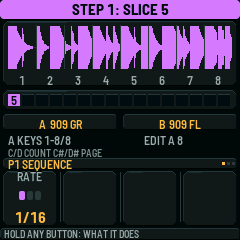
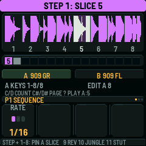
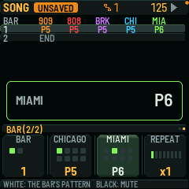

# DnBOX

This is the keyboard manual for DnBOX on the SMK-37 Elite and SMK-37 Pro. Start with the four musical tasks in chapter 3.

## Contents

1. This manual and the firmware version
2. The panel
3. Quick start: real musical tasks
4. First sound
5. First pattern
6. First bass line: Chicago, then Miami
7. First break
8. Save, and why it waits
9. Step versus sound
10. The mixer, the effects and the master
11. Patterns, chains and song
12. Recording and free play
13. Knob motion, p-locks and chance
14. GLOBE settings
15. MIDI, USB audio and Bluetooth
16. Loopy clip mode
17. Install and update safety
18. Troubleshooting
19. Expert shortcuts
20. Parameters
21. Credits
- Appendix A. Same key, different job
- Appendix B. Names from the older FM-1 build
- Appendix C. Technical protocol reference

---

## 1. This manual and the firmware version

DnBOX turns an SMK-37 Elite or SMK-37 Pro into a live groovebox. It has a 909, an 808, a BREAK player, and two bass slots.

The bass slots can run Chicago, Miami, Juno or Drone. Chicago is the 303 engine. Miami is never a 303. Juno and Drone are not 303 engines.

Elite and Pro share the same playing surface. The USB product name and the Bluetooth name differ. The controls do not.

**Version.** This manual describes the **0.0.26 hardware-test candidate** built from source `94197fc8`, as listed in the [nightly installer catalog](https://gobbajogger.github.io/x0x37-for-Loopy-Pro_nightly/versions.json). This is **not a published, hardware-qualified release**: startup and restart have not been verified on hardware for this exact 0.0.26 package. The **recommended published release (hardware qualification incomplete)** is [0.0.25.1](https://github.com/gobbajogger/X0X37-for-Loopy-Pro/releases/tag/v0.0.25.1). Its release notes report Elite testing without a confirmed installed-package hash; Pro has no reported device test. It has Chicago and Miami, but **not** Juno, Drone or held-key chord recording. Do not follow those 0.0.26-only steps on 0.0.25.1.

For a first beat, bass line and saved pattern, use chapter 3, then chapters 4–8. Chapter 19 gathers shortcuts. The [browser companion](https://github.com/gobbajogger/X0X37-for-Loopy-Pro/blob/wip/musician-manual-97a88b/web/MANUAL.md) explains installing, samples and project files; it does not replace the keyboard guide.

This book describes the controls in the pinned development source, not proposed screens or a fully device-qualified release.

---

## 2. The panel

Hold any one button for 900 ms, with no other key or turn. A help card names the printed legend and says what the button does here. Then let go. The release does nothing.

For BT, the help card comes at 400 ms. For every other button, the hold is 900 ms.

Why: many printed words are not the job. BT is Save, not Bluetooth. NOTE REPEAT opens the mixer. KNOB BANK opens Loopy clip mode. The help card uses the word on the plastic.

The table below is the glossary for this whole book. The left column is the printed SMK legend. The middle column is the DnBOX function name this book uses. Use one term for one thing.

| Printed on the SMK | Function name | What it does |
|---|---|---|
| FX | FX | Reverb and delay. With SEQ: panic (all notes off). |
| SCALE | SCALE (list / yes) | Opens this screen as a list. Confirms a question. In clip mode, SCALE is a real scale control. |
| CHORD | CHORD (accent) | Hold plus a key: accent. In clip mode, CHORD is a real chord control. |
| NOTE REPEAT | NOTE REPEAT — mixer (when clip mode is off) | When clip mode is off, NOTE REPEAT is the mixer (MIX), not note-repeat. Hold plus a key: slide on Chicago. In clip mode, a release of NOTE REPEAT alone is panic. With ARP: LATCH. The lamp means the mixer. |
| PARA | PARA (sound) | Sound of the selected part. On a drum part, white keys audition only. They do not write steps. |
| GLOBE | GLOBE (settings) | Settings. Press again to close. Bluetooth lives here. |
| PATCH | PATCH — HOME / SONG / back / no | A tap (release, with no modifier) toggles HOME and SONG: from HOME it opens SONG, and from SONG it opens HOME. From every other view, that same tap opens HOME first. In a list: back. In a question: no. Hold as a modifier. |
| BT | BT — Save (not Bluetooth) | A tap (release before 250 ms) saves, or queues the save until stop. At 250 ms, still held alone: the toast is `CHOOSE PASTE TARGET`, then a white key pastes. If you let go after 250 ms and before 400 ms, with no paste, that release still saves. At 400 ms the help card appears, and the release does nothing. Bluetooth is GLOBE, then BLUETOOTH. The lamp means unsaved, queued or failed, not wireless. |
| ARP | ARP (TB-3PO) | Line generator on a bass slot, including Juno or Drone. On 909, 808 or BREAK, the toast is `TB-3PO: PICK CHICAGO OR MIAMI`. |
| SEQ | SEQ (steps) | Step grid or piano roll. A cold start lands here on the 909. |
| SEQ PLAY | SEQ PLAY | Start or stop, on press. |
| SEQ REC | SEQ REC | Record on or off, on press. |
| OCTAVE− / OCTAVE+ | OCTAVE− / OCTAVE+ | The meaning depends on the screen. See Appendix A. |
| `<` `>` | `<` `>` (page / list value) | With no list: one page step, no hold-repeat. In a list: the value. Hold-repeat is 400 ms, then 80 ms. |
| KNOB BANK | KNOB BANK — Loopy clips | A single press (the moment you press it, not a hold) toggles Loopy clip mode. The toast is `LOOPY CLIPS` or `LP OFF`. |
| FADER BANK | FADER BANK | Bank A or bank B. The LED is on for bank B. |
| K1 | MASTER | Volume. This knob has no taught role. |
| K2 | K2 (page / chance / tempo) | Page or list row. Held-step chance. PATCH plus K2 sets tempo. |
| K3 | K3 (part) | Walks 909, 808, BREAK, bass slot B and bass slot A. The default bass engines are Chicago and Miami respectively. In a list: the value. |
| K4 | K4 (pattern) | Cue a pattern. On HOME, all five parts. On a part SEQ screen, this part. This also ends a chain. On a bass PARA engine page, K4 selects a preset instead. |
| K5–K8 | K5–K8 | The four values at the bottom of the screen. |
| 16 pads | Pads | The pads follow the 16 white keys. |
| Faders 1–4 | Faders, bank A or B | Bank A: levels for 909, 808, BREAK and bass B (default Chicago). Bank B: bass A (default Miami) level, reverb return, delay return, and master FILTER. Soft pickup. |
| Pitch / mod wheels | Pitch wheel / mod wheel | Pitch bend on every bass engine. The mod wheel is cutoff on Chicago, wobble depth on Miami, CUTOFF on Juno (parameter 2), and BRIGHTNESS on Drone (parameter 1). The wheels do not write the saved pots. |
| 37-key keybed | Keys | The middle 27 keys match the older 27-key layout. The outer ten keys are live. Some outer keys also page BREAK slices. |

SEQ PLAY, SEQ REC and KNOB BANK act on the press. KNOB BANK needs only that single press. Almost every other button acts on release, and only if you did not already use it as a modifier.

On the step grid, with the keyboard off, the header shows the part chip and the word `SEQ`. A cold start shows the 909 and `SEQ`.

If record is on and the bass keyboard is on, that word is `SEQ KEYS`. If FREE PLAY is on, that word is `FREE PLAY`. On HOME the header word is `HOME`. On SONG it is `SONG`. In clip mode the left chip is `LP`.

On PARA, for a drum or a bass slot, the usual header is compact. It shows the part or engine name, page dots, the play icon, and a 2-pixel save dot if unsaved. It does not show the word `SEQ`. It does not show the word `SOUND`. It does not show the word `UNSAVED`. There is no `EDITING: SOUND` banner, and no `PROJECT SAVED` panel.

The PARA footer points you back to the steps: `SEQ: STEPS`. On a drum part it also says `BLACK: SELECT` and `WHITE: SOUND` (or `KEY SOUND OFF`). On a bass slot it says `KEYS: SOUND`.

**Reading the small symbols.** `NEXT` with a blinking pattern number means the pattern is queued, not playing yet. Amber `CHN` and an underline mark a live pattern chain. A 2-pixel dot on PARA means there are unsaved changes, **not** that saving finished. `SEQ KEYS` is the bass keyboard view; `FREE PLAY` plays without writing notes. `LP` means Loopy clip mode. See chapters 8, 11, 12 and 16 for the matching controls.

---

## 3. Quick start: real musical tasks

This chapter is a short path through four real musical tasks. Each step points to the chapter that states the same fact.

Do these tasks on the SMK-37 after a start. A saved project may already contain music; use an empty pattern if you want to follow the beat exactly, or preserve existing steps and add only the unlit ones you want. A short tap on a lit step removes it. Do not use Loopy clip mode for these tasks. A single press of KNOB BANK leaves this instrument.

### Make a drum beat

1. Stay on the 909 step grid, or press SEQ to return to it. See First sound.
2. Do not tap PATCH. A tap of PATCH opens HOME. Do not press KNOB BANK. KNOB BANK opens Loopy clip mode.
3. While playback does not run, press black key 1. This selects the bass drum (`BD`). You hear it.
4. Press white keys 1, 5, 9 and 13. These write kick steps on the selected track.
5. Press black key 7. This selects the clap (`CP`). Press a white key to place a clap step. See First pattern.
6. Press black key 8. This selects the closed hat (`CH`). Place hat steps the same way.
7. Press SEQ PLAY to start the pattern. Press SEQ PLAY again to stop.

### Play and record a bass line

1. Turn K3 clockwise from the 909. Three clicks select bass B (Chicago by default). Chicago is the 303 engine. See First bass line: Chicago, then Miami.
2. Four clicks select bass A (Miami by default). Miami is never a 303. For this task, choose Chicago or Miami on the slot’s PARA SOUND page if its engine was changed.
3. Press PARA to play the selected bass slot. The 37 keys play that slot.
4. Press SEQ to return to the bass step screen. Turn K2 to the SEQUENCE page and set DIR with K7 to `FWD` or `REV` for running recording. Press SEQ REC to turn record on. The toast is `RECORD ON: KEYS + KNOBS`. See Recording and free play.
5. On SEQ with record on, the bass keys play and write notes. PARA auditions the keys but does not write local key notes into the sequence.
6. Press SEQ PLAY to start the pattern. Play the bass line on the keys.
7. Press SEQ REC again to turn record off. The toast is `RECORD OFF`.

### Save a project, and power-off

1. If the pattern runs, press SEQ PLAY to stop. See Save, and why it waits.
2. Tap BT. A tap is a release before 250 ms. BT is Save, not Bluetooth.
3. If the toast is `REC OFF TO SAVE`, press SEQ REC to turn record off. If playback is running, stop it; release held notes and wait until the unit is quiet.
4. Look for the toast `SAVED`. That toast lasts 1300 ms. The unit writes only after you stop and the machine stays quiet.
5. Autosave is on by default. After 4 s of quiet, while stopped, the unit can save on its own, at most every 20 s. The toast is `AUTOSAVED`.
6. Power the unit off, then on. The unit loads the last written project. It does not keep other live edits.
7. If the unit has no valid saved project, it starts with empty parts.
8. A chain does not return after power-off. The project does not save a chain. See Patterns, chains and song.

### Live set: switch, mute and chain

1. If you are not on HOME, tap PATCH to open HOME. The header word is `HOME`. See Patterns, chains and song.
2. If you are already on HOME, do not tap PATCH again. That tap opens SONG.
3. Your existing pattern remains selected when you enter HOME. A white key or pad selects that number for **all five parts**: choose it only when you intend that change. There are 32 patterns in two banks: 1–16 and 17–32.
4. On HOME or SONG, press OCTAVE+ for patterns 17–32. Press OCTAVE− for patterns 1–16.
5. Turn K4 to cue a pattern. A pending cue shows a NEXT glyph and a blinking pattern number.
6. On HOME, press a black key to mute a part in display order. Black keys 1 to 5 mute 909, 808, BREAK, bass B and bass A (Chicago and Miami by default).
7. Hold the first white key and press the second to make a chain. A live chain shows a small amber `CHN`.
8. A chain is live only. The project does not save a chain. A save or a power-off does not keep it.
9. Press one white key to end the chain. Turn K4 to end the chain as well.
10. HOME keys make no sound. Press SEQ to return to the grid.

---

## 4. First sound

The unit starts on the 909 step grid. The header shows the 909 chip and the word `SEQ`. You are already on the right screen. You do not need to press SEQ.

On a first start, or when the unit has no valid saved project, every part is empty. After a written save, a later start loads that project. See chapter 3.

Why: a cold start is ready for the first drum pattern. The first sound is a 909 kick on the grid.

Do not tap PATCH yet. A tap of PATCH (a release with no modifier) leaves SEQ and opens HOME. HOME keys make no sound.

Do not press KNOB BANK yet. A single press leaves this instrument and opens Loopy clip mode. The toast is `LOOPY CLIPS`.

If you tapped PATCH, you are on HOME. A second tap of PATCH opens SONG, not the grid. On HOME and SONG, a tap of PATCH toggles those two screens. Tap PATCH again for HOME, then press SEQ to return to the grid.

If you pressed KNOB BANK, press KNOB BANK once more. The toast is `LP OFF`.

While playback does not run, press black key 1. This selects the bass drum (`BD`). You hear it.

Why: KEY SOUND defaults to `STOPPED`. A black key plays the drum only while playback does not run, or while you record. While the pattern plays, a black key only selects the track. This avoids a stray hit on a live pattern.

Press white keys 1, 5, 9 and 13. These write steps on the selected track.

Why: on SEQ, a white key writes or removes a step. An empty step turns on immediately. A lit step turns off if you tap it for less than 300 ms. A longer hold keeps the step so you can edit it.

Press SEQ PLAY. The pattern starts. Press SEQ PLAY again to stop. Transport acts on the press.

---

## 5. First pattern

Stay on 909 SEQ.

Press black key 7. This selects the clap (`CP`). While stopped, you hear it. Press a white key to place a clap step.

Press black key 8. This selects the closed hat (`CH`) on the 909. Place hat steps the same way.

Why: each black key is one drum track. The 909 tracks in order are `BD`, `SD`, `LT`, `MT`, `HT`, `RS`, `CP`, `CH`, `OH`, `CR` and `RD`. The last row on the grid is accent (`AC`).

The 16 pads follow the 16 white keys. You can write the same steps on the pads.

On SEQ, the SEQUENCE page sets LENGTH and RATE on K5 and K6. The default rate names are `1/16`, `1/16T`, `1/32`, `1/8T`, `1/8` and `1/4`. Length can run to 64 steps. OCTAVE+ and OCTAVE− move the visible 16-step page (`1-16`, `17-32`, `33-48`, `49-64`).

Swing for the whole pattern sits on HOME, on the `PERFORM` page (K6), not on this SEQ page.

To mute a track from SEQ, hold PATCH and press that track's black key. If you release PATCH with no key, the view changes to HOME. See chapter 4 for how to return.

---

## 6. First bass line: Chicago, then Miami

Turn K3 clockwise from the 909. The part order is 909, 808, BREAK, bass B, then bass A. The default bass engines are Chicago and Miami.

From 909: one click is 808. Two clicks are BREAK. Three clicks are bass B (default Chicago). Four clicks are bass A (default Miami).

Why: the screen follows this display order, not an older "two 303s then a break" tour. Count the clicks against this order.

### Chicago

Chicago is the 303 engine. It is the default engine on bass slot B. On HOME, Chicago sits after BREAK, as the fourth of the five lanes. The default MIDI channel for bass slot B is 3.

On SEQ, the white keys are steps in a piano roll, when the bass keyboard is off. Hold a step: K5 sets the note, K6 the gate (`REST`, `NOTE` or `TIE`), K7 the accent, and K8 the slide. The SEQ bass footer is `HOLD + KNOBS: EDIT`. K2 sets chance. K3 sets velocity.

While SEQ is running with record on, CHORD plus a key and NOTE REPEAT plus a key write accent and slide. They do not write those flags on the SEQ piano-roll keys. Accent and slide are audible on Chicago.

Press PARA to shape the sound. Chicago's first pages are OSCILLATOR and FILTER 1, then FILTER 2, ENVELOPE, AMPLIFIER, ARPEGGIATOR and EFFECT. The first FILTER 1 knobs are CUTOFF, PEAK and ENV. There is no leftover TONE or VOICE page from an older 303 engine.

Try a filter sweep: with a Chicago line playing, open PARA and use K2 to reach FILTER 1. Turn K5 CUTOFF and K6 PEAK to shape its brightness and resonance, then return the knobs to taste.

Press ARP for TB-3PO, the line generator. On that screen, OCTAVE+ writes a new line into that slot's pattern. OCTAVE− mutates the line.

### Miami

Turn K3 one more click to bass A (Miami by default). Miami is never a 303. It is the default engine on bass slot A. On HOME, Miami is the rightmost lane when both slots still have their defaults. The default MIDI channel for bass slot A is 2.

Miami ignores accent and slide. A CHORD or NOTE REPEAT flag that you store still has no Miami accent or slide sound.

Press PARA to shape Miami. The pages are CARRIER, XMOD, FILTER, WOBBLE and OUTPUT. The first FILTER knobs include CUTOFF, CRUSH and WOBBLE. The first sound you hear depends on this engine, not on Chicago's pages.

The two bass slots are not identical. They can run different engines. Their defaults are already different.

**Sound presets versus projects.** The SOUND page offers the engine and its preset controls. Chicago and Miami have factory presets to recall. The current public packages do **not** import or export user preset files. To back up an entire song or setup, use [Projects](https://gobbajogger.github.io/X0X37-for-Loopy-Pro/projects/) and a portable `.x0xproject` file; that is not an individual sound preset. No Juno/Drone plug-in preset compatibility is claimed.

### Juno and Drone

Each bass slot can also run Juno or Drone. Choose the engine on the PARA SOUND page (`CHICAGO`, `MIAMI`, `DRONE`, `JUNO`).

ARP on Juno or Drone also opens TB-3PO, and OCTAVE+ writes a line into that slot's pattern. Accent and slide in the generated line follow the engine.

If the selected part is 909, 808 or BREAK, ARP does not open TB-3PO. The toast is `TB-3PO: PICK CHICAGO OR MIAMI`.

On this 0.0.26 candidate, Juno and Drone can record a held-key chord. With the chosen engine on a bass slot, stop playback, open SEQ and turn SEQ REC on. Press and hold one note, then add the other notes without releasing the first; they are grouped into the current step. Release the keys, turn record off and play the pattern. If the chord does not fit, the toast is `CHORD NOT SAVED`. This is note recording for the current bass slot, not the separate CHORD control in Loopy clip mode. The manual does not promise a chord-name or inversion display.

For a Juno chord, open PARA and reach LFO/CHORUS with K2; adjust K8 CHORUS while playing the chord to explore the chorus setting. For Drone, reach STRING and adjust K6 BRIGHTNESS while holding a note or chord; ENVELOPE offers ATTACK and RELEASE for its onset and tail. These are starting points, and the result depends on the sound settings.

Do not call Juno or Drone a 303.

### The bass keyboard

When the keyboard is on, the 37 physical keys play the selected bass slot. The keyboard is on in PARA, in record, or in FREE PLAY. FREE PLAY is a SEQ KEYS page. With record off, the keys play and write nothing; strike velocity is used for auditioning. SEQ note recording uses a fixed velocity.

---

## 7. First break

From the 909, turn K3 two clicks clockwise to BREAK. Do not turn four clicks.

On SEQ, the white keys are the bar, not a drum track. This is a sample player. The feel is different from a 909 or 808 grid.

SEQ pages for BREAK include SEQUENCE (RATE: `1/16`, `1/8` or `1/4`), GROOVE and RETRIG.

PARA opens LOOPS. There you pick LOOP A and LOOP B, and you set slice counts (`A SLICES`, `B SLICES`: `4`, `8`, `16`, `32`).

Black keys 1 to 8 hold a slice of LOOP A (the footer is `STEP + 1-8: PIN A SLICE`). With a loop available and LOOP A set to at least 8 slices, stop playback. Release the slice keys and press the outer C♯3 key until the first slice page is selected. Choose an empty white-key step, hold it and tap black key 5: the step is created and pinned to slice 5. Check for the `STEP n: SLICE 5` toast; an existing step already pinned to slice 5 instead returns to the generator. Start playback to hear it at that step. White keys can also add or remove steps while running. Repeat the held-step and black-key gesture to return that step to generated slice selection. Outer D♯3 moves to the next slice page; black keys 1–8 address that page. Local slice performance keys do not record pins merely because SEQ REC is on. Black keys 9, 10 and 11 are momentary live keys: 9 is REV, 10 is JUNGLE, and 11 is STUT. The footer is `9 REV 10 JUNGLE 11 STUT`. A press of one of those three starts the effect. A release ends it.

Some outer keys page the BREAK slices. The middle keys still play the live path when the keyboard owns them.

On BREAK, the white keys write the bar on SEQ and also on PARA. The drum audition rule does not apply to BREAK.

To put your own loops on the unit, use the browser sample tools in `web/MANUAL.md`. This control book does not repeat that procedure.

---

## 8. Save, and why it waits

The printed legend on the Save button is **BT**. A tap of BT saves the project, or queues the save until it is safe.

Bluetooth is not this button. Bluetooth lives in GLOBE, in the BLUETOOTH section.

Why the wait: a flash write stops the audio. The unit does not write during play, during record, or while notes or clip activity are busy. If you tap BT then, the toast is `SAVES WHEN STOPPED`, or `SAVES WHEN QUIET`, or `REC OFF TO SAVE`.

The usual header can show `UNSAVED`, `SAVE AT STOP`, `SAVE WHEN QUIET` or `REC OFF TO SAVE`. If the left side is already full, that shrinks to `*`, `Q` or `!`. A 2-pixel amber (or red) dot stays at the right. On the PARA compact header, only that 2-pixel dot appears. There is no `SAVE QUEUED` title, and no `PROJECT SAVED` panel.

The unit writes only after you stop and the machine stays quiet. The toast is then `SAVED`, for 1300 ms. Failure toasts include `SAVE FAILED`, `NEWER DATA: NOT SAVED` and `MEMORY FULL: NOT SAVED`.

The BT lamp stays on while a save waits. It blinks for unsaved edits. It blinks fast after a save fails.

Autosave is on by default. After 4 s of quiet, while stopped, the unit can save on its own, at most every 20 s. The toast is `AUTOSAVED`. You can turn autosave off in GLOBE, under PROJECT.

To load the last saved project, open GLOBE, then PROJECT, then `LOAD SAVED`. If you have unsaved edits, the question is `LOAD SAVED PROJECT?` with `DISCARD UNSAVED EDITS`. SCALE is yes. PATCH is no.

The project does not save a chain. A chain is live only. See chapter 11.

To copy, hold BT for 250 ms, still alone. The toast is `CHOOSE PASTE TARGET`. Then press a white key to paste. If you let go after 250 ms and before 400 ms, with no paste target, that release still saves. At 400 ms the help card appears, and the release does not save. Hold BT plus OCTAVE to pick the copy bank (`P1-16` or `P17-32`).

---

## 9. Step versus sound

Keep this split. It is easy to confuse, and an older book was wrong here.

| | SEQ (steps) | PARA (sound) |
|---|---|---|
| Enter | Press SEQ. The SEQ lamp is on. The header word is `SEQ` (or `SEQ KEYS` / `FREE PLAY`). | Press PARA. The PARA lamp is on. |
| What you see | The drum kit grid, or a bass piano roll. | The sound pages. The usual header is compact: the part or engine name, and a 2-pixel save dot if unsaved. It does not show `SEQ`, `SOUND` or `UNSAVED`. |
| White keys on a drum part | Write or remove steps on the selected track. | **Audition only.** The white key plays the selected sound. It never writes a hidden step. The footer is `WHITE: SOUND` (or `KEY SOUND OFF`) and `SEQ: STEPS`. |
| White keys on a bass slot | Steps in the piano roll, when the keyboard is off. | The keys can play the sound. The footer is `KEYS: SOUND` and `SEQ: STEPS`. |
| White keys on BREAK | Write or remove steps on the bar. | The same write. The drum audition rule does not apply. |
| Hold a bass step plus K5–K8 | K5 note, K6 gate (`REST` / `NOTE` / `TIE`), K7 accent, K8 slide. Not a p-lock. | A p-lock for that step, including a step you still hold from SEQ. The tag is `P-LOCK STEP n`. |
| Hold a drum or BREAK step plus K5–K8 | These knobs stay on the SEQUENCE page (LENGTH / RATE). They are not p-locks. Hold the step, press PARA, then turn K5–K8 to lock. | A p-lock. The tag is `P-LOCK STEP n`. |

Why the audition rule: PARA white keys must not write steps. A player who opens PARA to change the sound must not also change the pattern. The step stays on SEQ. The sound stays on PARA.

If you hold a step and then try to leave PARA for SEQ, the toast is `RELEASE STEP FIRST`. Release the step, then press SEQ.

A turned knob replaces the bottom of the screen for 900 ms with a large readout. For a drum, the name looks like `BD  DECAY`. There is no banner that says `EDITING: SOUND` or `EDITING: THIS STEP ONLY`.

---

## 10. The mixer, the effects and the master

### The mixer (NOTE REPEAT)

When clip mode is off, NOTE REPEAT opens the mixer (MIX). Press NOTE REPEAT again for the next MIX page. The NOTE REPEAT lamp means you are on MIX, not that note-repeat is on.

The MIX pages are PARTS, 909 MIX, 808 MIX, MASTER and WAVE.

On PARTS, black keys 1 to 5 pick the part in display order: 909, 808, BREAK, bass B and bass A (default Chicago and Miami). The knobs are LEVEL, PAN, REV and DLY. The footer is `BLACK 1-5: PART` and `PATCH+BLK: MUTE`.

909 MIX and 808 MIX set Level, Pan, Rev and Dly for the selected drum track.

MASTER starts with Drive, a one-knob COMP, PUMP and FILTER. Further knobs include THRESH, RATIO, ATTACK, RELEAS, MAKEUP, MIX, PUMP BY, RESO, LIMIT, Dist, GLUE and Volume. WAVE shows the same first four knobs with a scope.

K1 is MASTER volume at all times.

### Faders

Press FADER BANK to switch bank A and bank B. The LED is on for bank B. A bank change rearms pickup and toasts `FADERS:` plus the short labels.

Bank A sets levels for the first four displayed parts: 909, 808, BREAK and bass B (Chicago by default).

Bank B sets the fifth displayed part (Miami, when that slot still runs Miami), then reverb return, delay return, and master FILTER.

The faders use soft pickup. Until a fader reaches the saved value, or crosses it, the header shows `PICK Fn UP` or `PICK Fn DOWN`. Pattern and tempo stay visible.

### FX

Press FX for reverb and delay. Press FX again for the next page.

REVERB knobs include DECAY and TONE. DELAY knobs include TIME, FEEDBACK, TONE and TAPE (from clean digital into worn tape). Further knobs include REV LOW CUT, REV RETURN, DLY LOW CUT, DLY RETURN and PING-PONG.

Each part's send levels live on the mixer, not on this FX screen.

### SMC

The SMC is a separate mixer on Bluetooth, not a firmware mode. In GLOBE, set `BT ROLE` to `SMC HOST`, turn Bluetooth on, and restart if the toast is `RESTART TO TURN ON`. Pick the `SMC PRESET` that matches the physical mixer (`DAW` or `USER`).

When an SMC mixer is on the link, the HOME footer shows `SMC F1-5: PART LEVEL` and `F6: REV  F7: DLY  F8: FILT`.

The eight SMC faders, left to right, follow display order: 909, 808, BREAK, bass B and bass A (default Chicago and Miami), then reverb return, delay return, and master FILTER.

Up and Down on the SMC change the SMC encoder bank. They do not change the keyboard page.

Pause locks the SMC targets immediately. The toast is `SMC TARGETS LOCKED`. A later press, held for 900 ms, unlocks. The toast is `SMC FOLLOWS PAGE`. A short press while locked peeks the locked page.

Pause uses the DAW Pause note. MMC STOP is separate: it stops transport, and it does not lock.

On a drum MIX or drum SEQ page, Bank Left selects drums 1 to 8. Bank Right selects drums 9 to 11. The last five strips of that second bank are inactive.

The SMC has its own pickup words: `PICKUP: MOVE UP TO TARGET` and `PICKUP: MOVE DOWN TO TARGET`. Clip mode, a question, or a busy project can toast `SMC LOCK UNAVAILABLE`. With no SMC mixer on the link, the HOME footer is `WHITE: PATTERN`, `TWO: CHAIN` and `BLACK: MUTE`. Until you press a button, the footer can say `HOLD ANY BUTTON: WHAT IT DOES`.

---

## 11. Patterns, chains and song

There are 32 patterns, in two banks: 1 to 16 and 17 to 32. On HOME or SONG, OCTAVE+ shows 17–32. OCTAVE− shows 1–16.

### HOME

A tap of PATCH (a release with no modifier) opens HOME from most views. The header word is `HOME`. The screen shows all five parts of the current pattern, in display order: 909, 808, BREAK, bass B and bass A (default Chicago and Miami).

On HOME, a white key (or a pad) selects that pattern for all five parts. Hold the first white key and press the second to make a **chain**. A live chain shows a small amber `CHN`. An amber underline marks chained slots. A chain is live only. The project does not save it.

Why: a chain is a performance tool. A saved project must not surprise you with a chain that you did not mean to keep.

One pattern selection ends the chain. K4 also ends the chain. K4 cues a pattern. A pending cue shows a NEXT glyph and a blinking pattern number. After the cue plays, that number is the current pattern.

On HOME, black keys mute parts in **display order**. Black key 1 mutes 909. Black key 2 mutes 808. Black key 3 mutes BREAK. Black key 4 mutes bass B (Chicago by default). Black key 5 mutes bass A (Miami by default).

The HOME `PERFORM` page has TEMPO, `SWING`, FILTER and PUMP. Default tempo is 125 bpm. The tempo range is 20 to 275 bpm. PATCH plus K2 also sets tempo from other screens.

The 909's length is the bar. Other parts can have other lengths, and they can drift. Swing is the 909 pattern's swing, on HOME `PERFORM` K6, and it applies to every part.

A cue, a mute or a pattern change from HOME does not play a sound on the keys. To write steps again, press SEQ.

**Different patterns for different parts.** Suppose your 909 beat is in pattern 5. On SEQ, use K3 to select a bass part, then turn K4 until that part shows pattern 6. While stopped it changes immediately; the 909 stays on pattern 5. Edit the bass part there. On HOME you can see the combination. A HOME white key changes all five parts, so pressing pattern 1 would leave that combination. On the bass PARA engine page K4 selects a sound preset, not a pattern; return to SEQ for this operation.

### SONG

If you are already on HOME, a tap of PATCH opens SONG. The header word is `SONG`. From SONG, a tap of PATCH returns to HOME. That is the toggle: HOME, then SONG, then HOME. There is no PATCH path straight back to SEQ. Press SEQ for the grid.

On SONG, a white key assigns its pattern number to **all five parts** of the selected bar, then advances to the next bar. Black keys toggle that bar's part mutes. SCALE opens a list with bar length, insert, delete and clear. Song length can run to 192 bars.

**Arrange the pattern 5 beat with a different bass pattern.** Start with the 909 in pattern 5 and a bass part in pattern 6 as above. Stop, open HOME with PATCH, then tap PATCH again for SONG. Press OCTAVE− to select patterns 1–16, then press white key 5 to make a bar with pattern 5 on every part. This overwrites the bar's five pattern choices; it does not preserve the live pattern 6 selection. Turn K5 back to that bar. On the second BAR page, reached with K2, turn the corresponding bass knob (K6 for bass slot B, K7 for bass slot A) until it reads 6. The first BAR page uses K6, K7 and K8 for 909, 808 and BREAK. Now this song bar plays the 909's pattern 5 and that bass slot's pattern 6. Choose another bar with K5 and set its parts as needed. Turn SEQ REC off before playback: SONG recording can write live choices into bars. Select the starting bar with K5, then press SEQ PLAY on SONG. Stop with SEQ PLAY. Save the project with record off and playback stopped to retain the arrangement.

If you press SEQ PLAY while the SONG screen is up, song mode stays on even after you leave SONG.

---

## 12. Recording and free play

Press SEQ REC to turn record on or off. This acts on press. The toast is `RECORD ON: KEYS + KNOBS` or `RECORD OFF`. A red record dot shows in the header. The SEQ REC lamp is on while record is on.

For local bass keys, press SEQ: with record on, stopped input writes stepwise and running input writes into the pattern. Running note recording requires forward or reverse direction; otherwise `REC NEEDS FWD/REV` appears. PARA keys audition but do not write local key notes into the sequence. On a drum part, black keys and knob moves can record.

On SEQ while playing with record on, CHORD plus a key writes an accent and NOTE REPEAT plus a key writes a slide. FREE PLAY with record off does not write these flags. On Chicago, those flags are audible. On the SEQ keyboard, NOTE REPEAT plus OCTAVE writes a tie. CHORD plus OCTAVE writes a rest.

On the SEQ piano roll, with the keyboard off, those modifiers do not write flags. Use K7 and K8 on the held step.

FREE PLAY sits on the SEQ KEYS page. The keys play the bass slot and write nothing. The header mode is `FREE PLAY`. The footer can say `FREE PLAY: KEYS PLAY`. Strike velocity is in use.

In Miami FREE PLAY, the top eight pads set wobble RATE. This is on SEQ or PARA, not in record, and not in clip mode. The rates are `1/2`, `1/4`, `1/8`, `1/16`, `1/3`, `1/6`, `1/12` and `1/24`. The footer caption is `PADS: RATE` plus the rate, for example `PADS: RATE 1/16`.

Pads 9 to 12 set wobble SHAPE: `TRI`, `DOWN`, `UP` and `SQR`. Pads 13 to 16 are empty. A press on those four does nothing.

External MIDI on a part's channel can record that part while record is on. This book does not claim a trial on a specific host.

If a recorded chord does not fit, the toast is `CHORD NOT SAVED`. Other record toasts include `NOTE SOUND NOT SAVED` and `REC NEEDS FWD/REV`.

---

## 13. Knob motion, p-locks and chance

A p-lock of a sound knob happens on PARA. Hold the step, and turn K5–K8. The knob tag shows `P-LOCK STEP n`. On a bass step, the roll also shows a `STEP n` line with the note and velocity.

On SEQ, those four knobs are not p-locks. On a held bass step they set note, gate, accent and slide. On a held drum or BREAK step they stay on the SEQUENCE page. Hold the step, press PARA, then turn K5–K8 to lock.

Hold a step (on SEQ or PARA) and turn K2 to set chance (probability) for that step. Turn K2 down from 100%. After 5%, the next values are A:B patterns (`1:2`, `2:2`, `1:3` and so on, through `8:8`). The A-th of every B passes. The toast shows `STEP n: 1:2`, or a percent. On a bass step, hold the step and turn K3 to set velocity.

BT plus a knob forgets that knob's motion. BT plus a knob on a p-lock removes the lock.

To record a sweep, choose a part with notes, open its PARA sound page, turn SEQ REC on and start SEQ PLAY. Move a sound knob as the pattern runs. Turn record off and let the pattern loop: the recorded movement plays back. Moving that knob while not recording takes control for a pass; the stored motion can resume on a later pass. BT plus that knob removes its motion. This is separate from the faders' soft pickup.

A chance miss is a rest for both the internal sound and MIDI out.

---

## 14. GLOBE settings

Press GLOBE to open settings. The list title is `GLOBAL`. Press GLOBE again to close and return to the previous view. PATCH in a subsection goes back one level. PATCH at the root closes.

SCALE opens a screen as a list, runs a list row, or answers yes to a question.

The six sections are `MIDI + CLOCK`, `BLUETOOTH`, `AUDIO`, `KEYS + SCREEN`, `PROJECT` and `SYSTEM`.

**MIDI + CLOCK.** `CLOCK SOURCE` is `AUTO`, `INTERNAL` or `EXTERNAL`. `CLOCK OUT` and `NOTES OUT` are on or off. Each part has a MIDI channel (see chapter 15). On the SMK there is also `CLIP KEYS CH` for clip mode.

**BLUETOOTH.** `BLUETOOTH` is on or off. `BT ROLE` is `DEVICE` or `SMC HOST`. `SMC PRESET` is `DAW` or `USER`. `STATUS` and `NAME` are read only.

The name is the advertised Bluetooth name (chapter 15). If the controller only starts at power-on, a change can toast `RESTART TO TURN ON`. A later flush can toast `BLUETOOTH SAVED`. This settings bit is separate from the project save on the BT button.

**AUDIO.** `OUTPUT` is `NORMAL` or `LOUD`. `USB AUDIO` is `FOLLOWS KNOB` or `FULL`. `TUNE` is a global bass fine-tune for the slots together. Each part has an on/off row.

The on-screen name is the engine display name. For drums and BREAK, that is `909`, `808` or `BREAK`. For a bass slot, that is `CHICAGO`, `MIAMI`, `JUNO` or `DRONE`. When both slots share an engine, the screen adds a slot letter, for example `CHICAGO A`. `BASS A` and `BASS B` are slot IDs, not the row labels. `QUEUE MUTES` and `NOTE LOCK` also live here.

**KEYS + SCREEN.** `LIGHTS` is `OFF`, `ON` or `KEYS`. `KEY SOUND` is `STOPPED` or `ALWAYS`. `THEME` is `GREEN`, `AMBER`, `CYAN`, `RED`, `MONO` or `LIGHT`.

**PROJECT.** `SAVE PROJECT`, `LOAD SAVED`, `AUTOSAVE`, `CLEAR PATTERN` and `RESET PROJECT`. Reset asks `RESET PROJECT?` with `SAMPLES ARE KEPT`.

**SYSTEM.** `PERFORMANCE`, `ABOUT DnBOX` and `BATTERY` (read only). About shows `ABOUT DnBOX` and a line that starts `DnBOX ` plus the version.

---

## 15. MIDI, USB audio and Bluetooth

### What the computer shows

The USB product string is `DnBOX ` plus the version plus ` SMK-37 Elite`, or the same with ` SMK-37 Pro`. The USB manufacturer string is `X0X`. Hosts typically show the product string. This pass did not check the exact words on each operating system.

There is no TRS MIDI IN on the SMK. The SMK TRS jack is a MIDI OUT jack. The firmware does not use it. Do not look for a MIDI IN jack on this keyboard.

### MIDI channels

Default channels stay with the slot, not with the engine name:

| Slot | Default engine | Default channel |
|---|---|---|
| 909 | 909 | 10 |
| 808 | 808 | 11 |
| Bass A | Miami | 2 |
| Bass B | Chicago | 3 |
| BREAK | BREAK | 4 |

A channel of OFF sends and takes no notes. On a bass slot, the on-screen row uses the engine display name plus ` MIDI CH`. The slot itself does not move. Saved data and MIDI maps keep these slot IDs.

On the 909, incoming General MIDI drum notes map as follows. Kick is 36, snare is 38, and the toms are 41, 45 and 50. Rim is 37, clap is 39, closed hat is 42, open hat is 46, crash is 49, and ride is 51.

The 808 uses the same notes for the first six voices. Then cowbell is 56, cymbal is 49, open hat is 46 and closed hat is 42.

### Clock

To follow a computer's clock, connect USB, open GLOBE and set `CLOCK SOURCE` under `MIDI + CLOCK` to `EXTERNAL`. In the host, choose the DnBOX MIDI output as a clock destination and enable clock and transport send. Start the host: the unit follows incoming clock. If it waits, SEQ PLAY blinks slowly and the toast is `WAITING FOR CLOCK`; check the host's clock routing. Tempo in the header is amber with external clock. To play independently again, choose `INTERNAL`. Host menu names vary; this is source-based guidance, not a claim of a tested DAW setup.

### USB audio

USB audio carries the master output, and the host can also send audio back. `USB AUDIO` in GLOBE selects `FOLLOWS KNOB` or `FULL`. The USB product string is the same as for MIDI. This pass did not check exact host wording.

### Bluetooth

Bluetooth MIDI is in GLOBE, not on the BT button.

The advertised and GATT name is `SMK-37 Elite-` plus four hex digits, or `SMK-37 Pro-` plus four hex digits, for example `SMK-37 Pro-A1B2`. The four-hex suffix comes from a stable address. The `X0X-` prefix is not the SMK name.

The BLE-MIDI service UUID and characteristic UUID are the standard BLE-MIDI values. See Appendix C. Those identifiers must stay the same.

The unit answers APC Device Inquiry over Bluetooth, with the same identity as over USB.

### Wheels and MIDI

On every bass engine, the pitch wheel bends pitch, without writing saved pots. The mod wheel is cutoff on Chicago, wobble depth on Miami, CUTOFF on Juno, and BRIGHTNESS on Drone. A gesture stays with the bass slot it started on. Record can record bend motion.

---

## 16. Loopy clip mode

A single press of KNOB BANK (the moment you press it, not a hold) enters clip mode. The toast is `LOOPY CLIPS`. The header shows `LP`. This leaves the normal instrument UI.

Why this chapter sits after the first-path chapters: that one press leaves the normal instrument. SCALE, CHORD, ARP and NOTE REPEAT then belong to the Loopy clip keybed. Know how to leave before you use it live.

A single press of KNOB BANK again returns. The toast is `LP OFF`.

In clip mode, NOTE REPEAT is not the mixer:

- SCALE is a real scale control.
- CHORD is a real chord control.
- ARP belongs to the clip keybed.
- NOTE REPEAT alone, on release, is panic: all notes off, and control change 123. The toast is `PANIC`.
- NOTE REPEAT plus ARP toggles LATCH. The toast is `LATCH ON` or `LATCH OFF`.
- PATCH plus SEQ REC and PATCH plus SEQ PLAY are Loopy history, not the DnBOX undo and redo. PATCH release does not change the DnBOX view.
- Loopy owns the SEQ PLAY and SEQ REC lamps. SEQ PLAY also sends the clip play note unless you hold PATCH.

Do not treat NOTE REPEAT as the mixer while clip mode is on.

DnBOX identifies itself to Loopy as an APC40 mkII for compatibility. Loopy mappings rely on that identity, not the USB product name. Protocol details are in the [developer reference](https://github.com/gobbajogger/X0X37-for-Loopy-Pro/blob/97a88b44539110ded82257ebb20b0444ba4b8b8f/docs/PROTOCOL_IDENTIFIERS.md).

---

## 17. Install and update safety

**First installation from M-VAVE factory firmware:** No DnBOX app or DnBOX project exists yet. You cannot make a DnBOX `.x0xslots` sample backup or `.x0xproject` project export from the factory app. Preserve any existing factory data through a manufacturer-supported backup method, if available. In desktop Chrome or Edge, connect by USB, allow MIDI/SysEx access, and choose a **listed, admitted** package for the model printed on the keyboard in the [main web installer](https://gobbajogger.github.io/X0X37-for-Loopy-Pro/install/). The installer may refuse a first write if the current firmware cannot provide the required sample-layout preflight; **stop if it refuses** rather than bypassing the check.

**Updating or reinstalling DnBOX:** If DnBOX is already running, save its samples and project as described below before using the same admitted-package workflow. The main site's **local `.fwsc` and stock firmware chooser remains hidden and disabled**; downloading a package from Releases does not make it uploadable there. To return to factory firmware, use the exact-model package and official [M-VAVE M-UPGRADE](https://www.m-vave.com/download) instructions. The [browser companion](https://github.com/gobbajogger/X0X37-for-Loopy-Pro/blob/wip/musician-manual-97a88b/web/MANUAL.md) explains these paths.

**Check the model printed on the keyboard**, Elite or Pro, not only the USB name. An older Elite can report Pro. A shared USB name does not prove the physical model.

A wrong-model write can make the keyboard unusable. Cancel writes nothing. The installer already warns in these words. This book repeats that warning because a name mix-up has bricked a unit.

The package identity that admits a write is `SMK-37 Elite_900` or `SMK-37 Pro_900` (release builds append a version code). That identity is not the everyday USB product string. Do not choose Elite or Pro by reading the USB product name.

USB names are not sufficient to identify a model for a safe write. Package and loader protocol identifiers are documented separately in the [developer reference](https://github.com/gobbajogger/X0X37-for-Loopy-Pro/blob/97a88b44539110ded82257ebb20b0444ba4b8b8f/docs/PROTOCOL_IDENTIFIERS.md).

While the unit is in the update loader, the USB product is `SMK-37 Elite Update` or `SMK-37 Pro Update`.

Before **updating or reinstalling an already-running DnBOX app**, stop playback and recording, export a separate `.x0xslots` sample archive and a portable `.x0xproject` project, and verify both downloads exist. These DnBOX exports are not available from factory firmware before the first DnBOX installation. The main installer blocks writes if a required sample backup fails; the nightly installer may warn and **continue without a backup**, risking permanent sample loss. Keep USB connected until the write has finished.

If **only the update loader** responds after an interrupted install, the normal app's sample reader is absent: do not expect a new sample/project export. The main installer's published-package flow has a loader-resume path, but only for an admitted package matching the physical model; it cannot recover unsaved samples. If no admitted package or reliable device identity is available, stop rather than attempt an unverified write. After a write, a matching app identity and a `Done` message are **not proof** that sound, reboot or sample restoration has passed physical testing. Check that the app actually runs and read back restored samples where possible.

Current public packages target **SMK-37 Elite and Pro only**. Starrykey 37 Play uses the Pro package. MKE-P37 has a distinct update identity and is **not** a third publicly offered package; do not substitute an Elite or Pro file for an unsupported identity. If the installer cannot confirm the physical model and package match, do not write.

---

## 18. Troubleshooting

**No sound after you press keys.** You are likely on HOME or SONG. HOME keys select patterns and mute parts. They do not play sound. Press SEQ to return to the grid. If you are on SONG, press PATCH for HOME, then press SEQ.

**The screen says `LOOPY CLIPS` or shows `LP`.** Press KNOB BANK again for `LP OFF`.

**The toast is `RELEASE STEP FIRST`.** Release the held step, then press SEQ.

**BT did not write immediately.** If the pattern was running or you were recording, the unit queues the save. The toast is `SAVES WHEN STOPPED` or a quiet or record variant. Stop, and let the unit go quiet. Then look for `SAVED`.

**You wanted Bluetooth and pressed BT.** BT is Save. Open GLOBE, then BLUETOOTH.

**The toast is `TB-3PO: PICK CHICAGO OR MIAMI`.** The selected part is 909, 808 or BREAK. Turn K3 to a bass slot (Chicago, Miami, Juno or Drone), then press ARP.

**The toast is `WAITING FOR CLOCK`.** The unit waits for an external clock. Set `CLOCK SOURCE` in GLOBE, or start the host clock.

**The screen says `DnBOX CRASH`.** The firmware halted. The title is `DnBOX CRASH`, not an older product name. The screen stays for 4 s, with diagnostic numbers. Then the unit restarts itself. On the next boot, the unit can show `RESTARTED AFTER A CRASH`, or `THE SECOND CORE CRASHED`.

If the unit starts twice and fails, you can reach `DnBOX SAFE MODE`. The title is `DnBOX SAFE MODE`. The lines include `IT CRASHED TWICE`, `NO SOUND. USB IS ON:`, `REINSTALL FROM THE WEB INSTALLER.` and `PLAY: TRY AGAIN`.

In safe mode, nothing that makes sound runs. USB is already on for the web installer. Press SEQ PLAY to try the application again. Use a verified package for your printed model.

**An install failed or the unit only shows its update loader.** See chapter 17 and the [recovery decision](https://github.com/gobbajogger/X0X37-for-Loopy-Pro/blob/wip/musician-manual-97a88b/web/MANUAL.md#recovery-and-older-firmware). Check whether the normal app or only `ota-` loader identity responds before selecting a next step. Use only an admitted package for the printed physical model; a matching USB name alone is not enough. The loader does not supply a new sample backup.

**Faders do nothing at first.** They wait for pickup. Move each fader to the saved position, or across it. The header shows `PICK Fn UP` or `PICK Fn DOWN` until then.

**You opened PARA to change a drum pattern and the unit wrote no step.** PARA white keys audition only. Press SEQ, then write the steps.

---

## 19. Expert shortcuts

These shortcuts stay. They are part of live muscle memory. This book documents them. It does not ask for their removal.

Transport is on press. Almost every other button is on release. A hold that you use as a modifier consumes the release, so the view does not change. A PATCH release with no modifier does change the view. That is why a missed mute combo can land you on HOME.

| Shortcut | What it does |
|---|---|
| PATCH + SEQ REC | Undo (DnBOX). In clip mode: Loopy undo. |
| PATCH + SEQ PLAY | Redo (DnBOX). In clip mode: Loopy redo. |
| PATCH + K2 | Tempo. |
| PATCH + white key | Select a pattern from any screen. |
| PATCH + black key | Mute a track or a mixer channel. |
| BT + white key | Paste, after a copy hold. |
| BT + knob | Forget that knob's motion, or remove a p-lock. |
| BT + SEQ REC | Ask to clear this part. |
| Hold a bass step on SEQ + K5–K8 | Note, gate, accent, slide. Not a p-lock. |
| Hold a step on PARA + K5–K8 | P-lock. The tag is `P-LOCK STEP n`. On a drum or BREAK step, hold it on SEQ, press PARA, then turn the knobs. |
| Hold a step + K2 | Chance. Past 5%, A:B (`1:2` and so on). |
| Hold a bass step + K3 | Velocity. |
| CHORD + key | Accent, when the bass keyboard is on (record or FREE PLAY). |
| NOTE REPEAT + key | Slide on Chicago, when the bass keyboard is on. |
| NOTE REPEAT + OCTAVE | Tie, on the SEQ keyboard. |
| CHORD + OCTAVE | Rest, on the SEQ keyboard. |
| FX + SEQ | Panic, all notes off. The view does not change. |
| Two white keys on HOME | Chain (live only, not saved). |
| KNOB BANK | Toggle Loopy clip mode (`LOOPY CLIPS` / `LP OFF`). |
| K4 | Cue a pattern and end a chain on HOME or a part SEQ screen. On the bass PARA engine page it selects a preset. |
| Fader move after pickup | Set the same value as the matching knob. |
| Pitch and mod wheels | Bend, plus cutoff (Chicago), wobble depth (Miami), CUTOFF (Juno) or BRIGHTNESS (Drone), without writing saved pots. |

OCTAVE+ at power-on together with OCTAVE− starts HARDWARE CALIBRATION. That screen re-teaches every button and K2–K8. It never teaches K1.

PATCH plus SEQ REC undoes. PATCH plus SEQ PLAY redoes. Undo keeps up to 32 steps, in a 4 KiB pool. `LOAD SAVED` and `RESET PROJECT` start a new history.

A live bass note cancels if the owner, the arp, or the context changes. This is so a held key does not keep sounding in the wrong place.

---

## 20. Parameters

These names come from the control tables at this SHA. They are the words on the PARA and FX pages. They are not an older TONE / VOICE list.

### Chicago (the 303 engine)

| Page | K5–K8 |
|---|---|
| OSCILLATOR | WAVE, GLIDE |
| FILTER 1 | CUTOFF, PEAK, ENV |
| FILTER 2 | BITE, GNAW |
| ENVELOPE | ATTACK, DECAY, SUSTAIN, RELEASE |
| AMPLIFIER | ENV/GATE, LEVEL |
| ARPEGGIATOR | ON, RANGE, MODE, SPEED |
| EFFECT | TYPE, EDIT 1, EDIT 2 |
| SOUND | engine, preset, status |

The ARPEGGIATOR knob order on the page is ON, RANGE, MODE, SPEED.

### Miami (never a 303)

| Page | K5–K8 |
|---|---|
| CARRIER | WAVE, LEVEL, SUB, PITCH |
| XMOD | WAVE, LEVEL, TUNE, DEPTH |
| FILTER | CUTOFF, CRUSH, WOBBLE |
| WOBBLE | SHAPE, RATE |
| OUTPUT | GLIDE, STEREO, OUTPUT |
| SOUND | engine, preset, status |

### Juno

| Page | K5–K8 |
|---|---|
| OSCILLATOR | WAVE, SUB, WIDTH, LEVEL |
| FILTER | CUTOFF, RES, ENV, HPF |
| ENVELOPE | ATTACK, DECAY, SUSTAIN, RELEASE |
| LFO/CHORUS | LFO RATE, LFO DEPTH, CHO RATE, CHORUS |
| SOUND | engine, preset, status |

### Drone

| Page | K5–K8 |
|---|---|
| STRING | REGISTER, BRIGHTNESS, FLUTTER |
| ENVELOPE | ATTACK, RELEASE, LEVEL |
| SOUND | engine, preset, status |

### 909 and 808

909 tracks: `BD`, `SD`, `LT`, `MT`, `HT`, `RS`, `CP`, `CH`, `OH`, `CR`, `RD`, then the kit. 808 tracks: `BD`, `SD`, `LT`, `MT`, `HT`, `RS`, `CP`, `CB`, `CY`, `OH`, `CH`, then the kit.

PARA shows that track's sound knobs, four at a time. The named rank order is Tune, Tone, Attack, Sound, Decay, Snappy, Tail, P.Dpth, Pitch. Not every track has every name. For 909 BD, the first PARA page is Tune, Attack, Decay and P.Dpth.

Level, Pan, Rev and Dly for a drum track live on the mixer (909 MIX / 808 MIX). Drive and Dist live in the SCALE list, not on the first PARA page. A KIT page has an ACCENT depth for the kit.

### BREAK

SEQ: SEQUENCE (RATE), GROOVE, RETRIG, and further groove fields in the list. PARA: LOOPS (`LOOP A`, `LOOP B`, `B CHANCE`, and the BREAK level), plus slice counts.

### FX and master

FX REVERB: DECAY, TONE. FX DELAY: TIME, FEEDBACK, TONE, TAPE. Further: REV LOW CUT, REV RETURN, DLY LOW CUT, DLY RETURN, PING-PONG.

MASTER first row: Drive, COMP, PUMP, FILTER. Further: THRESH, RATIO, ATTACK, RELEAS, MAKEUP, MIX, PUMP BY, RESO, LIMIT, Dist, GLUE, Volume.

HOME `PERFORM`: TEMPO (20–275 bpm, default 125), `SWING`, FILTER, PUMP.

### TB-3PO (ARP), on a bass slot

ARP opens TB-3PO on any bass slot, including Juno or Drone. On 909, 808 or BREAK, ARP does not open it. GENERATE: DENS, ACCENT, SLIDE, OCTS. SCALE: ROOT, SCALE, OCTAVE, MUTATE. OCTAVE+ writes a new line. OCTAVE− mutates it.

### SEQ pages

Drums: LENGTH, RATE. Bass: LENGTH, RATE, DIR (`FWD`, `REV`, `PING`, `RND`), TRANSP, then PRESET (`PAT SOUND`) and KEYS (`FREE PLAY`).

---

## 21. Credits

DnBOX firmware is free software under the GNU General Public License, version 3. If you share the firmware, you must also share its source.

The 909 path comes from **9W9** by athousanddetails, based on **ER-99** by Matthew Cieplak. The 808 path comes from **8W8** by athousanddetails. The send reverb, delay and master stage are a port of 9W9 work, under GPL-3.0. The factory break generator comes from **BB Gen** by mestela.

Chicago is the 303-style engine in this firmware. Miami, Juno and Drone are also in this source. This book does not credit an older, removed 303 engine as the current bass sound.

The default UI font is Barlow Semi Condensed (SIL Open Font License).

M-VAVE and SMK-37 are trademarks of their owners. TR-808, TR-909 and TB-303 are Roland trademarks. DnBOX has no tie to M-VAVE, Roland or Hügelton Instruments.

---

## Appendix A. Same key, different job

The same physical control has more than one meaning. This table is the single map. The behaviour stays.

**White keys.** They mean steps on SEQ, patterns on HOME, and song-bar patterns on SONG. They also audition sound on PARA drums, and play bass notes when the keyboard is on. They take a paste while you hold BT. On HOME, hold one white key and press another to set the ends of a chain.

**Black keys.** They select drum tracks, BREAK slices, and part mutes on HOME, in display order. On BREAK, keys 9, 10 and 11 are momentary REV, JUNGLE and STUT. They also pick a mixer channel on MIX. Hold PATCH and press a black key to mute.

**OCTAVE±.** They move step pages, and they switch pattern banks 1–16 and 17–32. They also set the bass keyboard octave, and the octave of a held step. On TB-3PO they write a new line or mutate it. While you hold BT, they pick the copy bank.

**PATCH.** A tap (unused release) toggles HOME and SONG. From any other view, that tap opens HOME. The same button is also back, no, and a modifier.

**NOTE REPEAT.** When clip mode is off, NOTE REPEAT is the mixer. When clip mode is on, a release of NOTE REPEAT alone is panic. With ARP in clip mode: LATCH. Held with a key, when the bass keyboard is on: slide on Chicago.

**BT.** A tap (release before 250 ms) saves. At 250 ms, still held alone, the toast is `CHOOSE PASTE TARGET`. A release after 250 ms and before 400 ms, with no paste, still saves. At 400 ms the help card appears, and the release does nothing.

**SCALE.** List and yes, except in clip mode, where SCALE is scale.

---

## Appendix B. Names from the older FM-1 build

If you used the older FM-1 build, the printed legends and the book names were different. This appendix is the only place this manual uses those older names. New player text uses the SMK printed legends and the glossary in chapter 2.

| Older book or Felucca name | SMK printed legend | Use this now |
|---|---|---|
| EDIT | PARA | PARA (sound) |
| HOME (the button) | PATCH | PATCH. The HOME screen still uses the header word `HOME`. |
| SAVE | BT | BT — Save |
| GLO | GLOBE | GLOBE |
| SEL | SCALE | SCALE (list / yes) |
| ENV | CHORD | CHORD (accent) |
| LFO, MIX, MASTER (as the button) | NOTE REPEAT | NOTE REPEAT — mixer |
| ALGORITHM | K3 | K3 (part) |
| PRESETS | K4 | K4 (pattern) |
| SELECT (the knob) | K2 | K2 |
| KNOB 1–4 | K5–K8 | K5–K8 |
| PLAY, REC | SEQ PLAY, SEQ REC | SEQ PLAY, SEQ REC |
| OCT- / OCT+ | OCTAVE− / OCTAVE+ | OCTAVE− / OCTAVE+ |

The older book also used two player names for the bass slots, and it called both of them 303 engines. That was wrong for this firmware. Chicago is the 303 engine. Miami is never a 303. This book uses Chicago, Miami, Juno, Drone, Bass A and Bass B.

The older book used FM-1 panel drawings and an FM-1 install URL. This book is for the SMK-37 Elite and Pro. It has no FM-1 panel figure.

---

## Appendix C. Technical protocol reference

The everyday rule is simple: choose firmware for the **physical model**, then let the installer validate the package and device identity. A matching USB display name is not enough.

Developers maintaining the loader, Bluetooth MIDI, Loopy identity and project storage should use [Protocol identifiers](https://github.com/gobbajogger/X0X37-for-Loopy-Pro/blob/97a88b44539110ded82257ebb20b0444ba4b8b8f/docs/PROTOCOL_IDENTIFIERS.md), pinned to the source described by this manual. They are not extra buttons or steps for performers.
