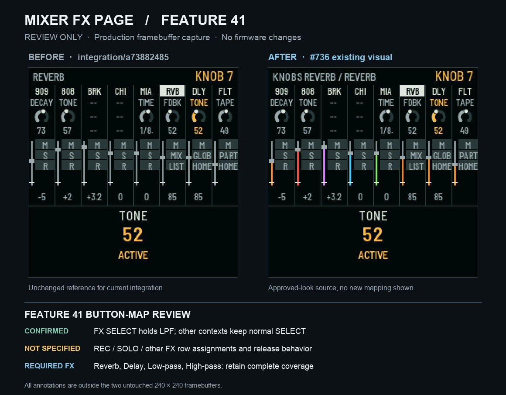

# Feature #41: mixer FX page, owner-spec recovery and real framebuffer preview

**Status: review-only, awaiting the owner's approval of the specific button map.** This is a stacked documentation/image change on top of [PR #736](https://github.com/gobbajogger/X0X37-for-Loopy-Pro/pull/736) at `dc4109b7dfcddda41168016d0a8c33143606c4dc`. It adds **no firmware changes** and must not enter frozen PR #734 until that PR clears its independently required gates.



## Owner requirements and unresolved assignment

The owner's original **`DnBOX-LoopyX0X37-full-feature-list-20261029.docx`**, item **41: separate mixer effects page**, specifies a distinct mixer FX page, functional context controls with truthful captions, SELECT momentary low-pass **in FX context only**, access to Reverb/Delay/low-pass/high-pass, clear effect-area navigation, and a coloured fader direction/amount indicator. The document says that exact per-button assignments must be recovered from the agreed owner map, **not invented**.

**NOT RECOVERED:** an exact owner-approved FX-specific mapping for the physical REC, SOLO and other button rows, including their desired press/hold/release semantics. The present screenshot does not imply that these buttons are already mapped or working as FX momentaries. This remains a blocker to calling Feature #41 built; a visual mockup cannot resolve it.

## Existing source searched; reuse rather than rebuild

- [#366](https://github.com/gobbajogger/X0X37-for-Loopy-Pro/pull/366): momentary SELECT effects on key 909/808/303A/BREAK buses, ROOM/TIGHT/ECHO presets.
- [#368](https://github.com/gobbajogger/X0X37-for-Loopy-Pro/pull/368) and [#369](https://github.com/gobbajogger/X0X37-for-Loopy-Pro/pull/369): correct bus-suited curated effects. [#372](https://github.com/gobbajogger/X0X37-for-Loopy-Pro/pull/372): extended SELECT FX handling to eight strips.
- [#620](https://github.com/gobbajogger/X0X37-for-Loopy-Pro/pull/620): SELECT ownership across FX and non-FX contexts.
- [#688](https://github.com/gobbajogger/X0X37-for-Loopy-Pro/pull/688) and [#725](https://github.com/gobbajogger/X0X37-for-Loopy-Pro/pull/725): original and integrated FX UI, LPF/RVB/DLY/MIX/CYC captions. Both explicitly describe Feature #41 as **partial**; #725 at `8dfb42be5a1fa9832d5638e65fb85766a5dd99ad` says REC/SOLO assignments were not recovered.
- [#736](https://github.com/gobbajogger/X0X37-for-Loopy-Pro/pull/736) `chat/mixer-fx-page-port@dc4109b7`: the approved-look port and real framebuffer fixture, reused without edits.
- Repository `docs/FEATURE-REGISTRY.md` and relevant FX, mixer and momentary branches/PRs were searched. The recovered evidence establishes **existing SELECT functionality**, not a complete exact REC/SOLO/remaining-row owner map.

Only a source-backed matching implementation should be ported after the actual map has been approved. Do not assign REC or SOLO to a guessed effect.

## Recovered remapping shortcut and bus-suited FX banks (owner clarification, 23:54/23:56 UTC+10)

The owner's two subsequent clarifications identify **(1) a shortcut for changing which effect a momentary button is assigned to** and **(2) multiple pages of effects chosen for each bus**. These are not proposals: the GitHub source includes implementations that can be reused.

| Operation | Owner-control combination in existing code | Exact source |
| --- | --- | --- |
| Select the effect for one bus | **Hold HOME + press that bus's SELECT key** (MIDI Notes 24–31, in the FX view) | `smc_fx_try()` calls `smcfx_cycle(bus, smc.fx_effect[bus])` |
| Select preset bank | **Hold HOME + Left/Right** (MIDI Notes 0x62/0x63) | `smc_fx_try()` calls `smc_fx_load_page()`; `SMCFX_NPAGE = 3` |
| Optional cutoff preset utility | **Hold HOME + Up/Down** (0x60/0x61) | `smc_fx_save_preset()` / `smc_fx_reset_cuts()`; these do **not** save the FX assignment map |

These exact combinations originate in [#366](https://github.com/gobbajogger/X0X37-for-Loopy-Pro/pull/366) `cursor/smc-fx-buttons-73de@08ccbdb18b4b139d9ab0b2dad56623ae958d5131` and its per-bus fixes [#368](https://github.com/gobbajogger/X0X37-for-Loopy-Pro/pull/368) `@e595bb380ac8f93cc145d2734eb988d0d76c9bf1`, [#369](https://github.com/gobbajogger/X0X37-for-Loopy-Pro/pull/369) `@80e6b60e105fb146939f2c61b7127f5eace1d76c`, [#372](https://github.com/gobbajogger/X0X37-for-Loopy-Pro/pull/372) `@d984b63cec2cd89d4a194b8fab491fae07e257ff`; the map was deduplicated in [#440](https://github.com/gobbajogger/X0X37-for-Loopy-Pro/pull/440) `@4d34df0ddd30315d4b5e92a03d8105678703c1f7`. Historical source and host tests are in `firmware/src/app/smc_mixer.c`, `firmware/src/app/smc_fx_map.h`, `firmware/src/app/smc_fx_map_tables.c`, and `tests/host/smc_fx_test.c`.

The **three preset FX pages in the exact #734 source** select the following effects for each bus:

| Bus | ROOM | TIGHT | ECHO |
| --- | --- | --- | --- |
| 909 | Reverb throw | Delay throw | Delay throw |
| 808 | Delay throw | Reverb throw | Reverb throw |
| 303A | High-pass | High-pass | Reverb throw |
| 303B | Low-pass | Delay throw | Reverb throw |
| BREAK | Decay gate | High-pass | Delay throw |
| Reverb bus | Reverb throw | 16th gate | Stutter |
| Delay bus | Delay throw | Stutter | Shuffler |
| Master | 16th gate | Trance gate | 8th gate |

**Source verification:** `SMCFX_PAGE` and `SMCFX_SUIT` in `firmware/src/app/smc_fx_map_tables.c` at [#734 `713dfd03`](https://github.com/gobbajogger/X0X37-for-Loopy-Pro/pull/734) are byte-identical to the table source tested in the existing #736 workspace (Git blob `fed6a46d14fca9361d934a65668d059fc8fce6f9`). Read-only table validation checked **24 of 24 preset cells** against their actual bus's curated suit list; all match. The ordered suit-choice counts are `[4, 4, 7, 6, 4, 7, 5, 7]` for 909, 808, 303A, 303B, BREAK, Reverb, Delay and Master.

**Critical implementation gap on frozen #734 `713dfd03`:** The shortcut and tables are **in source**. However, the current `smc_fx_try()` marks an ordinary held FX SELECT as `fx_lp_hold`, and `smc_fx_publish()` always passes `SMCFX_LP` for that held bus instead of `smc.fx_effect[bus]`. Consequently, changing the assignment or FX preset page does **not** select the effect heard during the SELECT hold. This is a source-path finding, not a physical device measurement. Switching pages also overwrites the current in-memory per-bus assignment with that page's preset. Existing REC and SOLO rows still run normal record/solo handling, not additional user-approved momentary FX, and the exact new row allocations remain unspecified. None of those behaviors has been changed in this review branch.

**Search scope:** repository registry `docs/FEATURE-REGISTRY.md`, audit [#739](https://github.com/gobbajogger/X0X37-for-Loopy-Pro/pull/739), 122-item plan [#699](https://github.com/gobbajogger/X0X37-for-Loopy-Pro/pull/699), relevant historical #366/#368/#369/#372/#440/#620/#688/#725/#736, all 823 live branch names (GitHub branches API, 9 pages including backups), related FX/SMC branch source, and available Mac snapshots of #736/#738. No second independent complete REC/SOLO remapping implementation was established. To avoid a duplicate feature implementation, reuse the existing tables and shortcuts after owner approval of the missing mapping and after #734 unfreezes.

**Focused host evidence (not a full qualification):** On the existing #736 native workspace, `sh tests/run_tests.sh smc-fx` completed exit **0** and reported `ok smc-fx`; its package test was explicitly **skipped**. The full host suite and Elite/Pro target builds are **NOT_RUN for this review-only change**. No sound/bit-exact or device claim follows.

## Real framebuffer provenance

The two **240 × 240** screen areas come from the real firmware `smc_ui_draw()` host renderer. They are pasted at 2× nearest-neighbour, pixel-for-pixel unchanged; all title, provenance and gaps are **outside** the captures. No SVG substitute or synthesized firmware interface was used.

- **Before:** existing [#736](https://github.com/gobbajogger/X0X37-for-Loopy-Pro/pull/736) baseline capture of `integration/all-in-one@a73882485f867d3ffeaea2c872f312fe4319295a`. Original source PNG SHA-256 `ee868130eafc7dab59ae5b948b29123ffbb23ef404b565a8acf3eb962294b13f`.
- **After:** fresh `#736@dc4109b7` renderer capture. The host checked `firmware/src/app/smc_mixer.c` Git blob `da2d1388b3b4f1ac98cc67490ddc72cf3fe7abb2` against source bytes. Raw framebuffer PNG SHA-256 `7d44c7f9f5fad66dc02fbc8b4b928097c3383ab035a57d4abcaf48b03d070abe`.
- **Review PNG:** `feature41-fx-button-map-review.png`, 1160 × 905 pixels, SHA-256 `288f3fe6c1fe7c090e2f4ec745619a29aa4b55730593efcf4004152eaf8efef1`. Exactly **1,355 of 57,600** source framebuffer pixels differ between the before and after images. The two enlarged source rectangles were checked pixel-for-pixel against their corresponding native captures.

Actual renderer invocation (on connected Mac-mini, source #736 checkout; no device I/O):

```sh
export PATH=/opt/homebrew/opt/python@3.12/libexec/bin:$PATH
cd /Users/mac/Documents/x0x37/pr736-api-proof/target
SMC_UI_TEST_FILE=tests/host/smc_fx_framebuffer_capture.c \
SMC_UI_OUT=/Users/mac/Documents/x0x37/pr736-api-proof/feature41-real-capture \
sh tests/host/smc_ui_test.sh
```

**PASS:** renderer command exit 0; actual `mixer-fx-page.png` captured, with one nonfatal `CK_FN` macro redefinition warning. **NOT_RUN for this review-only change:** complete host suite and SDK V1.2.1 Elite/Pro builds; firmware source was not edited. Never claim screenshot or renderer success as an Elite/Pro link result.

## Review gate and branch boundaries

The owner must first approve/recover the exact Feature #41 REC/SOLO/other-row mapping. **No firmware coding before that approval.** Keep this pull request a draft targeting `integration/all-in-one`, stacked on #736; #734 is frozen until full host suite and Elite plus Pro target builds have 0 fail and 0 skip on one exact head. Do not merge, flash, release, publish installer artifacts or alter `.github/`, sound engines or revision-13 storage.
