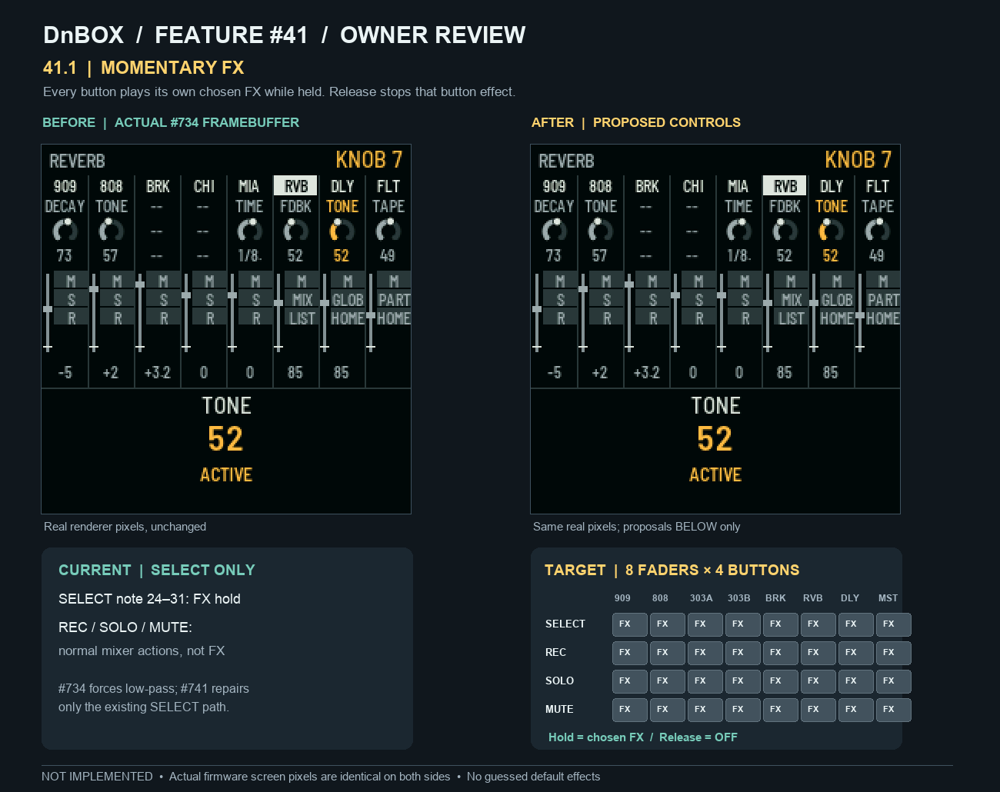
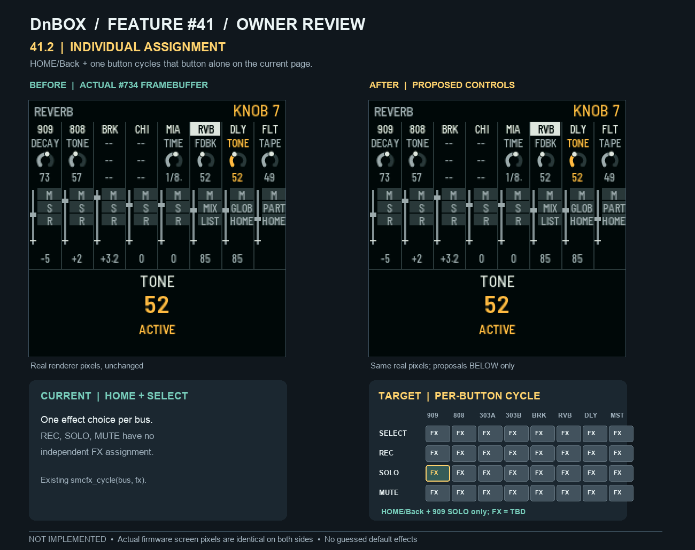
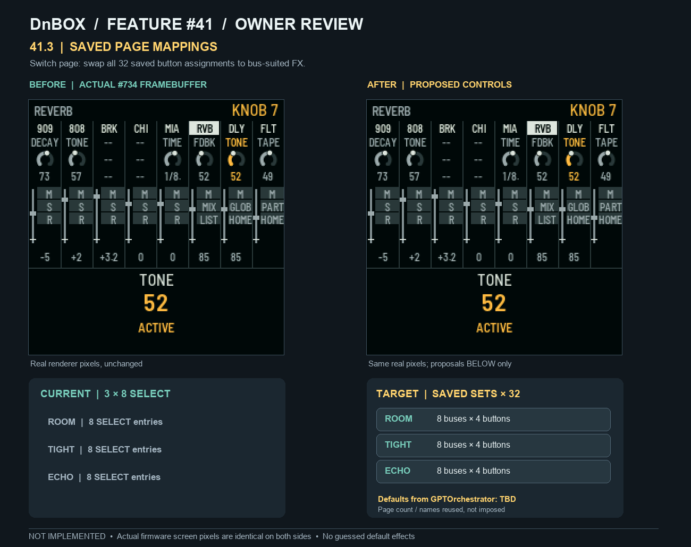

# Feature #41: owner-confirmed controls, 00:10 UTC+10

**Authoritative replacement for all earlier #41 definitions.** Three independently reviewed acceptance items under original ID **41**. The other 121 IDs remain unchanged. **Design/review only; do not write any additional 32-button Feature #41 firmware until the owner approves the mockups. The sole existing held-SELECT playback fix stays exclusively on [#741](https://github.com/gobbajogger/X0X37-for-Loopy-Pro/pull/741), not in this recovery/mockup PR. Do not merge into frozen #734 before its full host + Elite + Pro pass.**

The physical mixer has **eight fader strips**, each with four adjacent buttons, **SELECT / REC / SOLO / MUTE**, so the requirement covers **32 independently assigned momentary FX controls per FX page**. Button action is context-specific to the FX page. Existing behavior on other pages must be retained; controls outside FX are not silently repurposed.

## 41.1 — Momentary FX for all four button rows

> **Requirement:** Each SELECT, REC, SOLO and MUTE activates its own currently selected FX for its bus **only for the duration of its press**; release ends that momentary effect. **Never force LPF in place of the chosen FX.**

**Source:** #734 at `636c1f7013a1cf02e34b8d23031086777d898e7b`, `firmware/src/app/smc_mixer.c` (`smc_fx_try`, `smc_fx_publish`, `smc_fx_release_note`, `smc_button_apply`) has existing FX ownership only for SELECT MIDI notes 24–31; REC 0–7, SOLO 8–15 and MUTE 16–23 still perform their previous mixer functions. #366–#372 are historical SELECT FX reuse sources. [#741](https://github.com/gobbajogger/X0X37-for-Loopy-Pro/pull/741), `fix/smc-held-select-keeps-chosen-fx@1de9528e9b9a9981e88236971e73a378a3ffbc3e`, fixes **only** the selected-effect publishing on the existing SELECT route and remains a separate unmerged draft. The actual per-button FX default map is **TBD from GPTOrchestrator**; no assigned effect value is invented.

**Build status:** **NOT BUILT** for full 4-row behavior. #741 had a scoped **502/502 host assertion PASS** in Clang and UBSan on the SELECT-only route; these are **not** full #41, Elite, Pro, device or audio PASS. Full 32-button host suite and target builds **NOT_RUN**.

## 41.2 — Cycle only the pressed button's assignment

> **Requirement:** On the current FX page, hold **HOME/Back** and tap **any one** of the 32 buttons to cycle **that button's own** FX. No other button's assignment changes. The action must not switch pages or activate an unrelated FX by accident.

**Source:** #734 `smc_fx_try` currently handles HOME+SELECT via `smcfx_cycle(bus, smc.fx_effect[bus])` and `smc_fx_map.h` supplies bus-specific curated effect choices. That is **8 choices total**, one per bus, not 32 independently stored choices. #368/#369 supply bus-suited lists to reuse. `24214a8a` is an owner-referenced but **not yet resolvable** commit in canonical GitHub; check the future GPTOrchestrator recovery branch before writing any replacement.

**Build status:** **PARTIAL SOURCE / NOT BUILT** for 32 cells. Source inspection PASS for existing HOME+SELECT path, but all-button host and firmware target checks **NOT_RUN**.

## 41.3 — Complete saved mapping sets per FX page

> **Requirement:** Switching FX pages changes the **entire saved 8×4 mapping set**, including SELECT, REC, SOLO and MUTE. Every assignment must be appropriate to its bus, and changing pages must recall that page's saved mapping without corrupting the others.

**Source:** #734 `smc_fx_load_page`, `smc_fx_map.h:SMCFX_NPAGE`, `smc_fx_map_tables.c:SMCFX_SUIT/SMCFX_PAGE` provide **three existing page labels, ROOM/TIGHT/ECHO**, with **8 SELECT-only effect entries each**, plus curated per-bus effect suitability tables. These are reusable structures and historical labels, **not approved defaults for all 32 buttons**, nor a guarantee that the eventual owner-selected page count is exactly three. The page-specific *default* FX assignments are **TBD from GPTOrchestrator** and `24214a8a` is unverified.

**Build status:** **PARTIAL SOURCE / NOT BUILT** for full saved 32-button maps. The three existing 8-entry arrays are source-inspected only. Page-set save/recall host tests, Elite/Pro builds and hardware checks **NOT_RUN**.

## Real framebuffer and proposal integrity

- **Actual source:** isolated #734 `636c1f7013a1cf02e34b8d23031086777d898e7b` snapshot, `firmware/src/app/smc_mixer.c` Git blob `285dd022c1decb63e1239813b8c0a67b233adc1f`, `smc_fx_map_tables.c` blob `fed6a46d14fca9361d934a65668d059fc8fce6f9`; actual production canvas and `smc_ui_draw()` were compiled in the host test fixture `tests/host/smc_fx_framebuffer_capture.c`, reused from #736 **without changing firmware code**.
- **Capture command:** `SMC_UI_TEST_FILE=tests/host/smc_fx_framebuffer_capture.c SMC_UI_OUT=preview-render sh tests/host/smc_ui_test.sh` in the isolated snapshot with Python 3.12 / Pillow 13 tooling. **Exit 0**, one non-fatal `CK_FN` macro redefinition warning. No firmware build, device or audio operation.
- **Raw 240×240 PNG SHA-256:** `ee868130eafc7dab59ae5b948b29123ffbb23ef404b565a8acf3eb962294b13f`.
- All three before/after mockups embed **the exact same real captured screen pixels** on both sides, enlarged with nearest-neighbor scaling. The proposals concern the physical SMC **interaction**, so the 8×4 mapping diagrams are drawn **outside** the 240×240 framebuffer. No fictional post-implementation screen pixels were generated. **AFTER = PROPOSAL, NOT ACTUAL IMPLEMENTED RENDER.**
- Mockup file SHA-256: 41.1 `01d107b0d0b50ea32c55cc1df136ec6166d50556f6c506d2ca8621ae217e2bea`; 41.2 `ff1a4909b11fd18a18bb12969c7437df4800a17964f8fbf792633459a90ae071`; 41.3 `0a839054aedb4b646d2eaca32baa99c603af4e366c80b4768dd441e77bdbeca8`.
- The owner-referenced source `24214a8a` returned **GitHub commit not found**, and checks of accessible local Git repositories did not resolve it. Do not mark it implemented, absent everywhere, or merged. GPTOrchestrator's **future published source and defaults** are the next verified input.

## Gate and completion criteria (future implementation only, no code authorized in this review)

1. Owner reviews and approves each of the three labelled interaction mockups. Preserve any instruction to revise them without guessing defaults.
2. Verify the exact original `24214a8a` or GPTOrchestrator recovery branch on GitHub; identify reusable code, button map defaults, tests and source provenance. Port it only after approval; no second independent implementation.
3. Independent host tests must exercise all 32 buttons, held and lost releases, HOME/Back single-cell remap, independent page save/swap/restore, bus suit restrictions, dual peer events, and safe non-FX contexts, **without forcing LPF**.
4. Only after #734's frozen full host + Elite/Pro run passes, qualify integration on the exact pinned merged head with full 0-fail/0-skip host suite and both SDK V1.2.1 target builds. No merge, installer release or flashing is part of this review.

**Current outcome:** three owner-spec review items documented and three mockups supplied. **Firmware changes: none.** All three complete user-facing behaviors remain **NOT BUILT**, defaults **TBD**, owner approval required.
