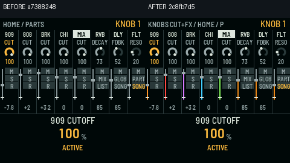
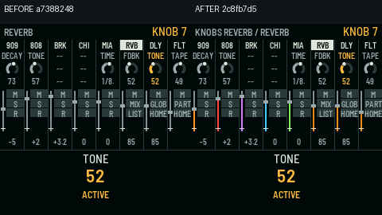

# PR #736: real framebuffer before/after, original #688 behavior

Source-accurate review, not a proposed redesign. The entire visual image inside each 240 × 240 panel comes from the firmware's **real production canvas and `smc_ui_draw()`**, compiled into the native host runner. Only 30 pixels above each raw image were added to identify the pinned comparison commits. The old hand-drawn SVG files are deleted.

## Mixer home: knob bank and fader travel



- Baseline `integration/all-in-one@a73882485` vs draft #736 `2c8fb7d5`, identical `setup(V_HOME, PART_303A)` / knob-0 input / preference fixture.
- Actual changed pixels: **1,290 of 57,600** (2.24%), same resolution, deterministic fixture.

## FX page: original effects and caption



- Same pinned code revisions, identical `setup(V_FX, PART_303A)` / knob-6 input fixture.
- Actual changed pixels: **1,358 of 57,600** (2.36%), native host-rendered pixels.

## Source parity, not new UI

The caption `Knobs CUT+FX`, the corresponding bank labels and the colored fader destination travel are **already in PR #688** at `7b2d1726f3515b319d5edcab34529007d33ab3a8`. See original `smc_mixer.c` functions `smc_ui_draw_peer()` and `smc_ui_grid()`. They are retained, as are the physical pickup marker and existing LPF/RVB/DLY/MIX captions. Neither screen adds a new page or changes DSP. The multi-peer context fix belongs to #736's adaptation to the current integrated peer architecture, not an added visual feature.

## Reproduction, real renderer

Read source from the GitHub API at exact commits:
- Before: commit `a73882485f867d3ffeaea2c872f312fe4319295a`, tree `1119204aa7726891174232e2beb783d4034edb4c`, `smc_mixer.c` blob `4b79cfc3f022f15b6ab165c8e046cac470c22d06`.
- After: commit `2c8fb7d5f975958bd0ef8c41b4ff44e39d5b0c6b`, tree `f234e5d5d0faba5992ccbd16b59ad464d5e7d1eb`, `smc_mixer.c` blob `da2d1388b3b4f1ac98cc67490ddc72cf3fe7abb2`.

Build and capture each source tree (copy `tests/host/smc_fx_framebuffer_capture.c` to the pinned baseline test directory for the **same** fixture):

```sh
SMC_UI_TEST_FILE=tests/host/smc_fx_framebuffer_capture.c SMC_UI_OUT=/tmp/mixer-fx-capture sh tests/host/smc_ui_test.sh
```

This existing host runner compiles the real firmware app and native LCD drawing code; it does not render an SVG or hand-drawn approximation. No device was flashed.

Recorded raw PNG SHA-256:
- HOME before: `0a23c02fe9ba41923d0a8711c02f7cf603792726ea317d3ccf3736068e497148`
- HOME after: `5a71ee3739eb711663bd387a7f8f13c63b467d9b92bffe825b8314958632a4ac`
- FX before: `ee868130eafc7dab59ae5b948b29123ffbb23ef404b565a8acf3eb962294b13f`
- FX after: `48fc7a8358792b9806fc5486694fcdd14b5faffceb59446f9f38cdaaf312b555`
- HOME paired PNG: `949d60331b793ed79521b90da9fce942a9e633aedf258a1f29e5cc9471a4184d`
- FX paired PNG: `923b4cb1229cbe6ebad6be519ad668d510b76dcd728c7e68568c7dd5ca2c9507`

## Test evidence at capture

- On the exact #736 pre-evidence source, native `smc_ui_test.sh`: **PASS, 8,967 checks**, including the actual framebuffer. 
- `smc_fx_page_port_test.sh`: **PASS, 67 checks**.
- `smc_fx_peer_view_test.py`: **PASS, 17 exact-source checks**.
- Full host suite and Elite/Pro V1.2.1 target builds must be reported separately with their actual outcomes. The screenshots and scoped tests do not satisfy the full merge gate.
- Draft freeze preserved; no new UI features or device actions.
