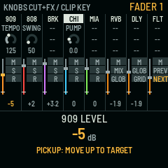
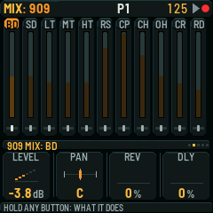
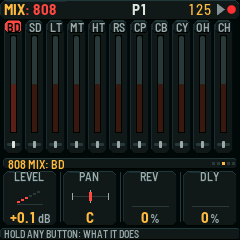
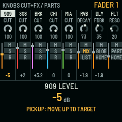
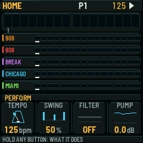
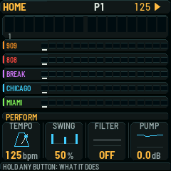
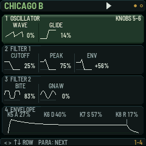
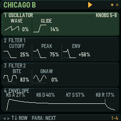

# Remaining #688 mixer UX port

Base: `build/0.0.23@bb1907494b8d1b52d52ac220dfeb9a0663ea3ee2`.
Source: `#688/wip/mixer-ux@7b2d1726f3515b319d5edcab34529007d33ab3a8`, plus the owner's supplied partial diff.
Delivery lane: `chat/mixer688-port-023`, draft PR into `build/0.0.23`. No integration or device qualification is claimed.

Clip-grid strip 8 now shows PREV/NEXT and moves the stage, while Up/Down changes encoder banks. Selecting or recording a locked kit restores its keyboard view/page. Unmute adopts a known matching physical fader, including zero, and the next move needs no pickup. The pickup marker and Pause LED follow the audio beat; both keyboard header paths use that same phase.

The supplied implementation is retained. Two target-branch conflicts were resolved: the active locked kit comes from `smc_drum_mix()` after locked page navigation, and the newer Part header needs the same play-icon phase rule. The existing four-row FX mapping and mapped-page peek remain the base implementation.

## Host proof

Executed on the connected macOS host with the complete, blob-verified API checkout and shipping Chicago/Miami engine composition. No device I/O.

| Check | Result |
| --- | --- |
| `sh tests/host/mixer_ux_test.sh` | PASS, 374 assertions |
| `smc-fx-caption`, `smc-pickup-acceptance`, `smc-lock-beat` | PASS |
| `smc-ui-popup`, `smc-mode-page`, `smc-mixer-page`, `smc-drum-mutes` | PASS |
| `smc-lock` | FAIL: `ui_project_begin() == 0`, candidate line 351 / untouched base line 347 |
| `smc-ui` | FAIL: existing row-four black-pixel assertion at line 524, same on untouched base |
| Full host suite, Pro target, hardware | NOT_RUN; outside this scoped draft delivery |

The selected runner reported eight PASS and two FAIL. Its unrelated Pro-package skip message is not a selected test PASS. The lock test's deliberate BANK expectations now assert the exact new Level destination; other frozen-target checks remain. The old test only passed those BANK cases coincidentally while the keyboard selection remained on the other bank. The new mixer test is registered in the runner's serial `G` class because it writes shared `build/gen` assets.

RED evidence before production edits: the original #688 test failed locked kit alignment at line 70. The added boundary test failed missing NEXT caption. GREEN covers clip captions/navigation/bank/overlay/lock boundaries, locked page-derived 909/808 selection, known/unknown faders and filter protection, RVB/DLY zero/nonzero adoption and immediate next movement, audio-clock stop/wait/continue, pickup lit/dim renders, Pause feedback and both header pixels at phase boundaries.

Existing host compiler warnings remain: CK_FN macro redefinition and the single-peer `smc_connected()` second-slot bounds warning. The initial native/host overlap also exposed shared generated break-bank inputs; the successful native measurement below was rerun with generation serialized.

## Measured native memory

Both commands used the same SDK V1.2.1 setup, JieLi compiler, Elite model and `X0X_DEV_PADCAL=1`, with no release flag:

```sh
X0X_DEV_PADCAL=1 MODEL=elite ./build.sh --board smk37
```

| Quantity | Exact base | Port | Delta |
| --- | ---: | ---: | ---: |
| Static RAM (.data + .bss) | 96,384 B | 96,384 B | **0 B** |
| Free static RAM (98,304 B region) | 1,920 B | 1,920 B | **0 B** |
| Pool used | 335,528 B | 335,528 B | 0 B |
| Pool free | 8,536 B | 8,536 B | 0 B |
| App image | 500,972 B | 501,516 B | +544 B |
| App code free | 51,700 B | 51,156 B | -544 B |

Both target builds exited 0. The supplied **2,352 B free** budget was not reproduced in this development configuration; its measured starting headroom was already 1,920 B. This port consumes none of either stated headroom. No package, firmware binary, SDK, toolchain or raw capture is included in this PR. The local build is proof of compilation and memory only.

## Actual framebuffer renders

These 240×240 PNGs come from the production firmware drawing functions and RGB565 framebuffer using the existing host harness. Hardware transport and clip-field storage use its existing substitutes. The clip captions and pickup marker are rendered by the real SMC grid renderer; the normal and Part headers use `ui_frame()`. They are implemented renders, not proposed mockups or device captures. Older UI presentations were reused, independently reviewed, then validated here.

| State | After render |
| --- | --- |
| Clip PREV/NEXT |  |
| Clip encoder bank 2 |  |
| Locked 909 / 808 selection |   |
| Pickup marker, beat lit / dim |   |
| Normal header, beat lit / dim |   |
| Part header, beat lit / dim |   |

## Independent source review

Compound Engineering review `mixer688-review` completed correctness, testing, standards and adversarial passes with no actionable findings. The active-kit and two-header conflicts were independently identified before implementation. No different-provider reviewer was available; the documented local adversarial fallback was used. The review's optional FX-return coverage gap was subsequently closed by the passing zero/nonzero and next-movement assertions. Review does not turn the baseline FAILs into PASS or authorize a merge.

## Next action

The integration owner can review this draft against `build/0.0.23`, resolve the two existing host failures in their owned scope, and obtain any required Pro/full-suite/device evidence before integration. No main/nightly merge, flashing, FM-1 operation, release or publication is authorized by this result.
