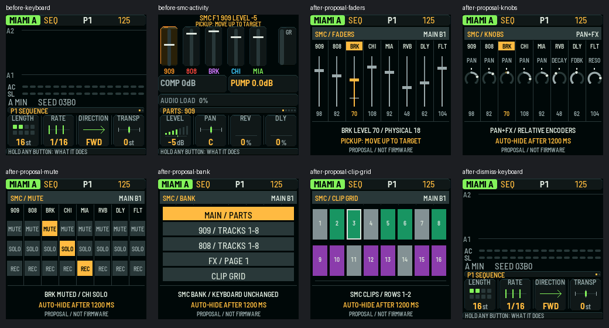

# SMC dedicated pop-up: review checkpoint

The current SMC page-peek path changes the keyboard's menus. The owner requested
a separate SMC renderer and state, with five screens and no keyboard navigation
writes. This draft presents that design for approval before code removal.

**PROPOSAL ONLY. Firmware is unchanged.** Supersedes #781; based on #785's
`build/0.0.23` at `bb1907494b8d1b52d52ac220dfeb9a0663ea3ee2`. No #788 changes
are ported. Continue implementation on this same PR after owner mockup approval.

See [the design](DESIGN.md), including proposed physical navigation, and the
[before/after contact sheet](mockups/before-after.png).



## What these images prove

The original PNGs are 240×240 real host RGB565 framebuffer captures. Before
images use the base firmware renderer; after images use a throwaway C renderer
with its own state and the production canvas/fonts. They are design mockups,
not integrated firmware, live Loopy feedback or hardware photographs. The
contact sheet only assembles unchanged original captures with filenames.

The capture checks keyboard navigation invariance for all five proposal screens
and exact keyboard pixel equality on dismissal. It does not implement or prove
production event isolation or automatic expiry. Illustrative fixture values and
clip colours are labelled as proposals. Generic native canvas/arc primitives
are reused; no keyboard menu painter is called by `popup_draw`.

Reproduce on the exact base with its existing host prerequisites:

```sh
X0X_HOST_DEFS=-Itests/host \
SMC_UI_TEST_FILE=docs/engineering-delivery/smc-dedicated-popup-023/proposal_capture.c \
SMC_UI_OUT=build/host/smc-popup-proposal \
sh tests/host/smc_ui_test.sh
```

## Actual baseline validation

The complete API source archive was CRC-checked and all 4788 blob hashes
matched the remotely pinned tree. `.github/` was excluded from extraction and
never edited. The scoped reconstruction used for host tests separately had
zero mismatches across 377 source/test input files. No production file changed.

| Check | Result |
|---|---|
| Proposal framebuffer capture | PASS: five screens, keyboard state/pixels preserved |
| SMC mapping, fader, feedback, filter, buttons | PASS; feedback includes 1920 expectations |
| SMC mixer pages | PASS: 340 checks |
| SMC mixer edges | PASS: 1281 assertions |
| SMC UI popup | PASS: existing peek/restore contract |
| SMC UI bounds | PASS: 287 checks |
| SMC mode/page | PASS: 1308 checks |
| SMC UI | FAIL on unchanged base: `smc_ui_test.c:524` pixel assertion |
| SMC lock | FAIL on unchanged base: `smc_lock_test.c:347`, `ui_project_begin() == 0` |
| SMC queue and link | FAIL on unchanged base: extracted harness lacks `smcfx_strip_t` |
| Full host suite | NOT_RUN |
| Integrated dedicated pop-up tests/builds | NOT_RUN: implementation awaits owner approval |
| Hardware | NOT_RUN; no device operations |

The baseline records are 10 passing and 4 failing suites. See
`baseline-tests.json` and `logs/`. Existing fixture warnings/failures were not
changed to make the baseline green. Host integration fixtures retain their
existing pad-calibration define; the native builds below explicitly use 0.

## Native baseline builds and RAM

Both real native builds passed using the pinned JieLi Clang 4.0.1 executable
SHA-256 `c45189ee624de0430deb0db02e6dce171fb5538e7fe323e3964dc8ac6236240f`
and all three SDK V1.2.1 packaging-file pins from `tools/build.py`.

| Model | Configuration | App size | Static RAM used | Free static RAM | Pool free |
|---|---|---:|---:|---:|---:|
| Elite | `X0X_DEV_PADCAL=0` | 499004 B | 95952 / 98304 B | **2352 B** | 8536 B |
| Pro | `X0X_DEV_PADCAL=0` | 498988 B | 95952 / 98304 B | **2352 B** | 8536 B |

Commands actually run on the verified base, with `JIELI_TOOLCHAIN` and `AC79_SDK`
pointing to verified local inputs and `X0X_GEN_CACHE` to workspace scratch:

```sh
X0X_DEV_PADCAL=0 python3 tools/build.py --board smk37 --model elite
X0X_DEV_PADCAL=0 python3 tools/build.py --board smk37 --model pro
```

These are **base** builds, not builds of an integrated new mixer. The prototype
state is 12 B on the host ABI; no post-implementation RAM delta is claimed.
Native binaries, toolchain and SDK bytes are excluded from this PR.

## Independent design check

The Superpowers builder check identified three issues: missing physical
navigation bindings, conflicting knob captions and an inaccurate clip-palette
provenance comment. The design and capture now address them. Production code
review and final candidate qualification remain pending implementation.

## Next action and boundaries

Owner: approve or revise these mockups and proposed bindings. Then implement
the independent UI, strengthen production isolation tests, rebuild both models,
measure the RAM delta and capture the final candidate on this same draft PR.
No code removal is shipped before approval. No merge, main/nightly changes,
GitHub Actions changes, flashing, FM-1 build or token handling was performed.

Superpowers and Compound Engineering skills informed this design checkpoint;
this is not a claim that the full implementation/shipping pipeline is complete.
