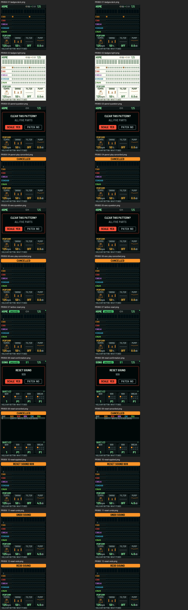

# UI render and interaction evidence for PR859 / PR860

Independent capture evidence for existing request LX-REQ-016. **Not candidate selection, full QA, design approval, native qualification or device proof.**

| Candidate | Commit | Capture result |
|---|---|---|
| [PR859](https://github.com/gobbajogger/X0X37-for-Loopy-Pro/pull/859) | `eea971c05ac35e91f7ba9449638221d985446f13` | exit 0; 115 assertions; 12 frames |
| [PR860](https://github.com/gobbajogger/X0X37-for-Loopy-Pro/pull/860) | `c97587c8cea40a8f6e534ec13d9690feb555486d` | exit 0; 115 assertions; 12 frames |

All 12 corresponding frame pairs are pixel-identical in these captured states. Frames use the actual production UI through the host LCD fixture and simulated panel/SMC input. No physical device was used.

[Full report and scope](REPORT.md) · [Source/input/frame hashes](manifest.json) · [Capture harness](capture.c) · [PR859 trace](859/interaction.log) · [PR860 trace](860/interaction.log)

Existing [QA requirement](https://github.com/gobbajogger/X0X37-for-Loopy-Pro/pull/860#issuecomment-6674866179) still requires the approved presentation/design-review reference. Existing UI owner and sole #698 integrator retain candidate selection and all remaining acceptance work. No new review round or owner is assigned by this evidence.

