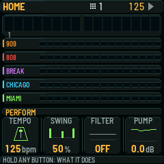
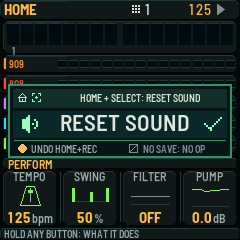
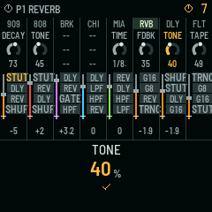
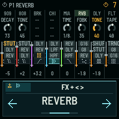
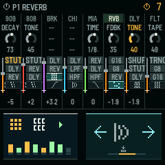
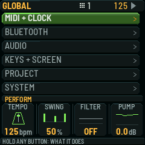
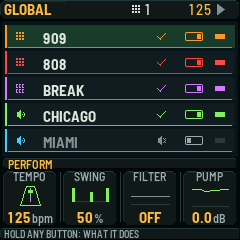

# Items 4, 6 and 7: production-framebuffer design review

**Status: VISUAL PROPOSAL ONLY.** Built from the actual 240×240 RGB565
framebuffer of firmware `build/0.0.24` at
`d8086cc09203945919c70d3c805f8ca3e6acbe5a`. The *before* states run
the unchanged production host/UI/SMC renderer. The *after* states run the
same renderer with extra review-only canvas/pictogram draws in
`render_only.c`. They do not represent implemented behavior. No
firmware feature files, input handlers, project format, or runtime state
are changed in this PR. No new device screen is proposed for Item 6.

## Visual pairs

| Item | Before | Proposed after |
| --- | --- | --- |
| 4: Restore saved sound |  |  |
| 6: Effect throw |  |  |
| 6: Drum fill |  |  |
| 7: Per-part settings |  |  |

## Item 4: SMC HOME + strip SELECT, outside the FX page

**Source audit:** `firmware/src/app/smc_mixer.c:1889-1901` routes
strip SELECT notes 24–28 to part selection and page navigation with no
HOME modifier check. The HOME-modified SELECT path is available to
assign. In contrast, keyboard `HOME + black key` already means mute
(`firmware/src/app/ui.c:3506-3512,3543-3547`) and remains unchanged.

The proposed chord resets only the selected part's **sound/engine
parameters to their project-saved values**. It must not restore mixer
level, pan, sends or mute. It must add one undo transaction so existing
HOME+REC undoes the reset. No accidental navigation from the SELECT
button on a successful chord. The transient sound/recall/check glyph
uses the existing HOME screen. The native-font **"HOME + SELECT: RESET SOUND"**
hint is paired with the HOME/SELECT and sound/check glyphs, while the larger
**"RESET SOUND"** label makes the action clear at performance distance.
The footer says **"UNDO HOME+REC"** and **"NO SAVE: NO OP"**: if the part
has no saved sound, the eventual handler must **do nothing**, without a
success notice or unintended navigation. Engine sound parameters are the
only reset target; level, pan, sends and mute remain unchanged. The labels
and glyphs here change only the mockup, not firmware behavior.

## Item 6: FX-page button priority and proposed fill placement

Both after-states retain the actual SMC **eight-strip mixer/FX window**;
no full-screen modal screen or new page is added. A momentary FX button
continues to represent one effect throw.

* When **exactly one FX button is held**, `<` / `>` steps the effect
  assigned to **that held button**. In the revised effect screenshot, the
  highlighted CHICAGO SELECT FX cell is actually assigned REVERB on the
  pinned factory map (verified in the render harness). The native
  23-pixel font displays **"REVERB"** large in a **single, full-width
  82-pixel footer**, beside clear arrow glyphs; the top hint reads
  **"FX + < >"** beside an FX/held-button pictogram. No extra left
  grid panel. This wins over HOME navigation.
* **SMC HOME + `<` / `>` changes the FX page only when no FX button
  is held**. On the FX page SMC HOME (note 6) is itself an FX key,
  so its held effect takes priority. The keyboard HOME modifier is
  a separate input owner.
* The stale `CYC` SELECT-caption concept is dropped from the proposed
  screen. The pictogram is the effect assignment, not a text instruction.
  This proposal does **not** remove the `CYC` string from firmware:
  `firmware/src/app/smc_fx_caption.h` still contains it in the base.
* **Drum fill candidate: BRK strip REC (SMC note 2)** on the FX page.
  It is immediately beside the 909/808 strips, tied visually to break
  and rhythmic activity, and avoids stealing the RVB/DLY/FLT master
  bus controls. The tradeoff is explicit: one of the 32 momentary
  FX buttons is reassigned to momentary fill, leaving 31 FX throws.
  The amber stepped/roll glyph indicates the assigned button, and the
  active-state screenshot uses brighter step accents. This mapping is
  a design recommendation awaiting owner selection, **not active
  functionality**.

The existing `smc_fx_arrow_owner` and `smc_fx_try` paths at
`firmware/src/app/smc_mixer.c:1665-1715` determine current precedence;
this PR does not edit them.

## Item 7: independent settings toggles

In the existing GLOBAL settings context, show one proposed toggle for
every sound part: **909, 808, BREAK, CHICAGO and MIAMI**. The pictogram
indicates a drum/break or synth, and the existing native on/off switch
shape displays each independent state. The illustration displays 909,
808, BREAK and CHICAGO on, MIAMI off **only to demonstrate both states**.
These are not current project settings, and the toggle is not connected
to engine state by this docs-only PR. A per-part enable control must be
distinguished from mute and mixer level when eventually implemented.

## Reproduction

Render from the **exact pinned source** with the host toolchain, Python
3.10+ and the source repo's normal host assets. In the repository root:

```sh
SMC_UI_TEST_FILE=docs/mockups/items-4-6-7-0.0.24/render_only.c \
SMC_UI_OUT=build/host/items-4-6-7-review \
sh tests/host/smc_ui_test.sh
```

`render_only.c` is a documentation-only capture fixture that uses the
production `host/x0x_host.c`, UI painter, SMC overlay, 9x9 production
glyph atlas, RGB565 framebuffer and `png_write`. The seven output files
are actual native framebuffer exports (240×240 RGB PNGs). The source
was retrieved by GitHub Git-data tree/blob API at the pinned SHA,
not by network git.

**Verification on the pinned source:** native Clang host capture command
exited 0; seven valid 240×240 PNG files; repeat capture from this
relative-path harness was byte-identical for all seven files; all four
before/after transitions differ. One pre-existing `CK_FN` macro
redefinition warning remains in the production host fixture. These
checks validate only the mockup renders, not functionality. Host full
suite, Elite/Pro firmware builds and hardware/device tests: **NOT_RUN
(not applicable to a documentation-only proposal)**.
