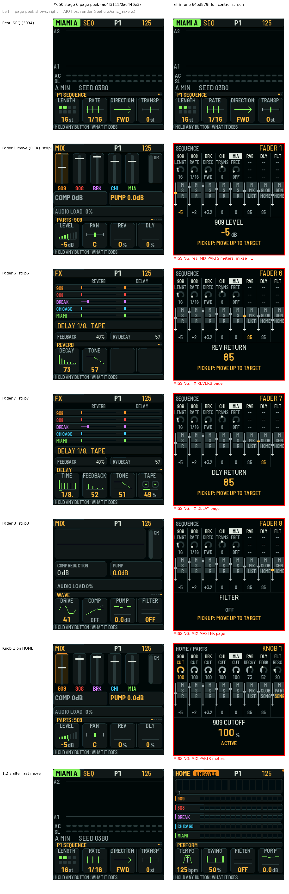

# SMC page peek (stage-6 branch) and the all-in-one control screen

Left column: the real MIX/FX pages that the page peek opens (host render).
Right column: the all-in-one host render at 64ed879f (`popup-650-vs-aio-shots.c`, run with `SMC_UI_TEST_FILE`).
Red frames show behavior that is missing.

Peek source: branch `cursor/smc-mixer-ui-popup-stage6-blocked-8e03` (b53545e9), commits ad4f3111, 0ad446e3, 116d9030, `smc_peek_begin`/`smc_peek_tick` in `firmware/src/app/smc_mixer.c`.
Note: PR #650 (a51b030d) does not contain the peek. It contains 0e00c262, the control screen.

| Behavior | AIO | Evidence |
| --- | --- | --- |
| Starts on a fader move (PICK and SMC F) | yes | smc_fader -> smc_show -> smc_ui_begin(n,0) |
| Starts on a knob turn (SMC K) | yes | smc_knob -> smc_show(n,1) |
| 1200 ms hold, extended by each move | yes | SMC_UI_MS; smc_ui_test test_activity |
| Opens the real MIX PARTS page, mixsel = strip (strips 1-5) | no | smc_ui_draw draws its own grid; ui.view is not changed |
| Strip 6 -> FX REVERB, 7 -> FX DELAY, 8 -> MIX MASTER | no | same |
| Shows live part level meters | no | smc_ui_grid has no meter draw |
| Restores view, page, mixsel and prev_view after the hold | yes (by design: nothing changes) | test_restore, framebuffer compare |
| No nested save when already on the mapped page | n/a | there is no save |
| Only home (main-mixer) targets peek | partly | AIO shows the screen for all targets, also drum banks and clip |
| Drum MIX pages skip | no (different) | AIO shows the screen on drum MIX/SEQ |
| Blocked in help | yes | smc_ui_begin / smc_ui_active check ui.help |
| Blocked in ASK | yes | ui.overlay == O_ASK check |
| Blocked in menu (O_LIST) | no (different) | AIO shows the screen over menus (test_overlays) |
| Blocked in clip mode | no (different) | AIO shows CLIP KEYS screen (smc_ui_clip_show) |
| Blocked in performance tests | yes | smc_message returns early when perf_testing() |
| SMC navigation cancels, no restore | yes | smc_button -> smc_ui_cancel; test_navigation |
| Panel navigation cancels | yes | input(), enc(), set_view call smc_ui_cancel |
| Project reset / SMC lost cancels | yes | smc_project_reset; context hash on project_revision |
| Panel and SMC LEDs follow the peeked view | no | AIO does not change ui.view; leds() follow the real view |
