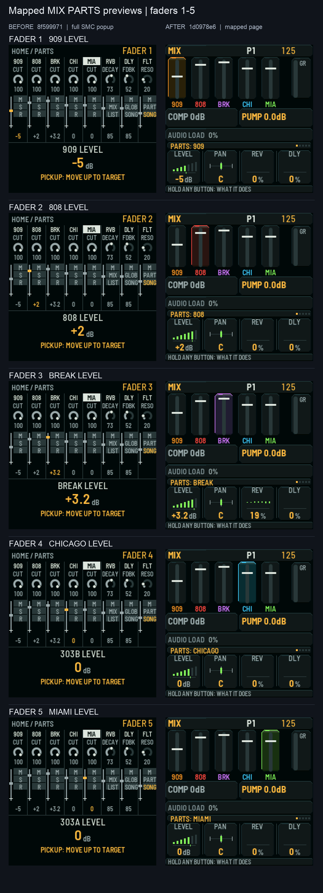
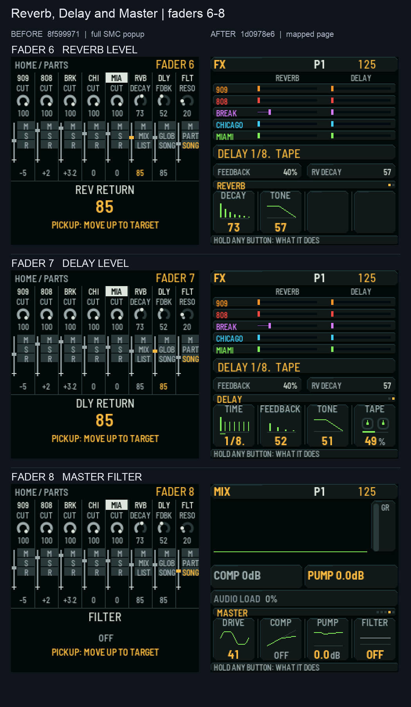
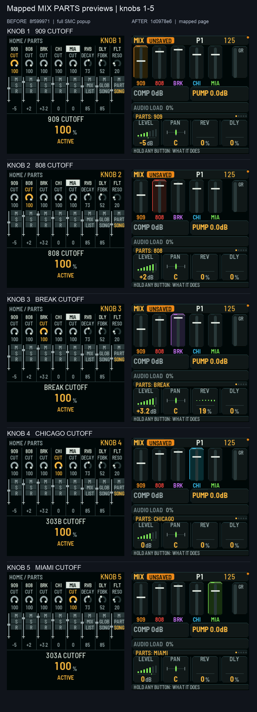
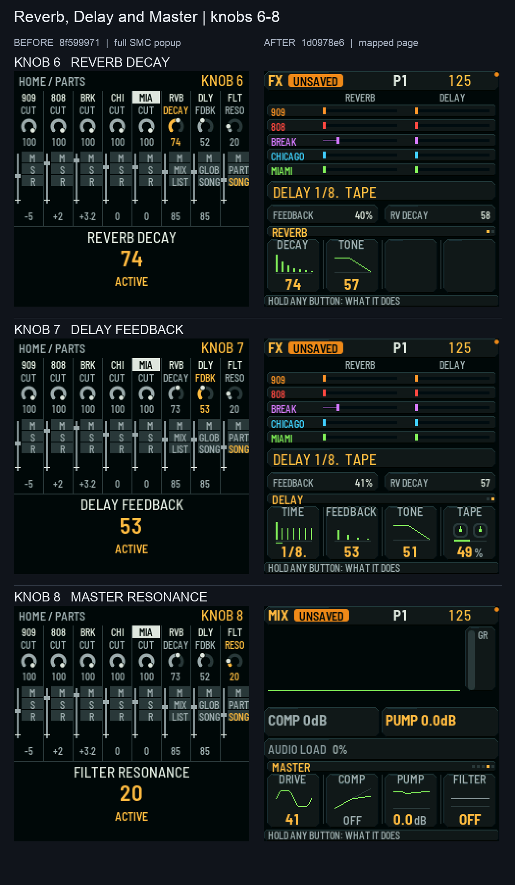
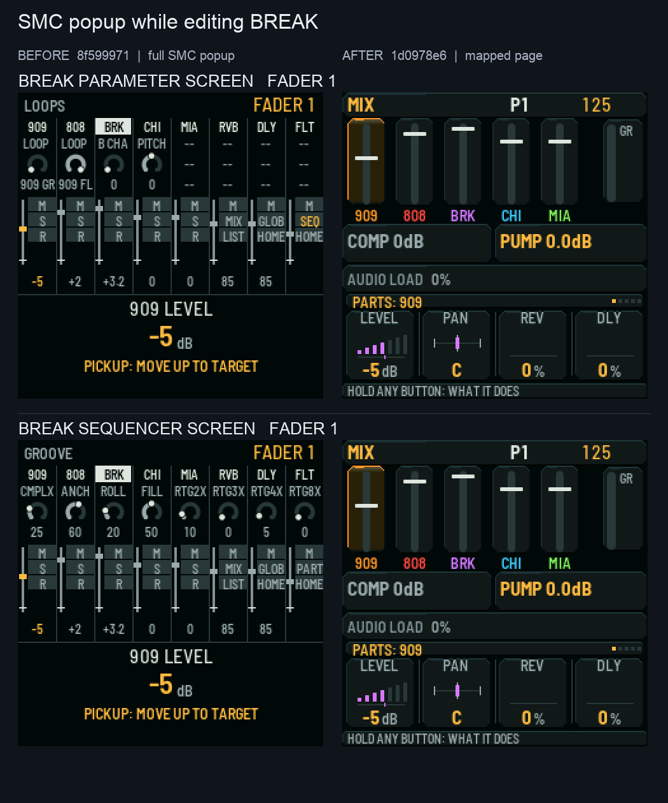

# PR #738: side-by-side real firmware framebuffer captures

**Review stage only. Do not change firmware code or merge this draft before the owner approves.**

These captures come directly from the production firmware UI framebuffer as executed
by the full application host harness (host/x0x_host.c, tests/host/smc_ui_test.c).
They are not design illustrations. Raw 240x240 RGB PNG frames are included
under raw/before/ and raw/after/, with SHA-256 hashes in provenance.json.

- Before: PR base 8f5999712998fb7a88d08e9d4ea5ae019338d523 (root tree 332d43ec29c41100e5ad5e536cb7737a2ddd9597).
- After: draft head 1d0978e62e7f1c3030dd96a6abadb331d099b362 (root tree 7aa098a78198f9aae14b5ccd279cff3d91250286).
- Both source trees reconstructed with verified Git blob SHA-1 and root-tree hashes
  via the #726 GitHub REST API recovery method;
  3,641 verified local objects reused and 523 missing objects fetched.
- Actual host capture: both builds and framebuffer capture runs returned exit code 0.
  One CK_FN macro-redefinition compile warning was emitted per build.
- 114 matching framebuffer screen states captured on each source;
  18 differed at one or more pixels, 96 matched exactly.
- All 18 differing screen states appear below (8 faders, 8 knobs, 2 SMC popup
  states while on BREAK). Native BREAK pages themselves matched.
- Only screen rectangles originate in firmware. Captions are outside them;
  2x scaling is nearest-neighbor and preserves every pixel.

## Every changed screen, side by side

### Mapped MIX PARTS previews | faders 1-5

Cases: FADER 1   909 LEVEL, FADER 2   808 LEVEL, FADER 3   BREAK LEVEL, FADER 4   CHICAGO LEVEL, FADER 5   MIAMI LEVEL.

### Reverb, Delay and Master | faders 6-8

Cases: FADER 6   REVERB LEVEL, FADER 7   DELAY LEVEL, FADER 8   MASTER FILTER.

### Mapped MIX PARTS previews | knobs 1-5

Cases: KNOB 1   909 CUTOFF, KNOB 2   808 CUTOFF, KNOB 3   BREAK CUTOFF, KNOB 4   CHICAGO CUTOFF, KNOB 5   MIAMI CUTOFF.

### Reverb, Delay and Master | knobs 6-8

Cases: KNOB 6   REVERB DECAY, KNOB 7   DELAY FEEDBACK, KNOB 8   MASTER RESONANCE.

### SMC popup while editing BREAK

Cases: BREAK PARAMETER SCREEN   FADER 1, BREAK SEQUENCER SCREEN   FADER 1.

## Evidence and limits

The sweep covers all eight standard firmware views, five selected parts,
their generated native pages, all eight HOME SMC faders, all eight HOME
SMC knobs, and BREAK-context popup/clip states. The 96 unchanged screens
are enumerated in provenance.json. The 36 original framebuffer PNGs for
the 18 changed states are included under raw/.

These are host framebuffer renders, not physical LCD or hardware claims.
They do not establish a full host suite PASS, either target firmware build,
sound bit-exactness, Bluetooth behaviour, or permission to merge/publish.
No SDK, toolchain, credentials, firmware binaries or source changes are
included in this visual evidence change.

The owner must approve these exact visual states before any implementation
changes are made to #738.
