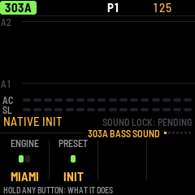
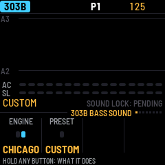
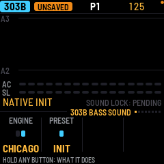
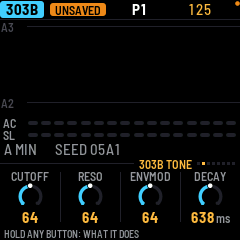
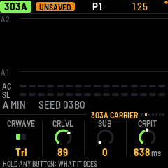

# Bass controls: actual-source proposal

This is a rendered, working host proposal behind `X0X_BASS_SELECTOR_PROPOSAL=1`.
The flag defaults to **0**. These controls are not rolled out, installed, or native-qualified.
The PNGs come from the actual `ui.c` renderer and input path, without GUI automation or an invented illustration.

## Existing product routing

Current source has one Miami/WBL1 context on 303A and Chicago/native303 on 303B.
The proposal's ENGINE control chooses that existing voice through normal part navigation.
It does **not** reassign engines to arbitrary voices. The 303A/303B header stays visible.
Builds without WBL1 do not offer Miami: both linked voices correctly name Chicago.

The PRESET control offers the one genuinely mapped native preset, **NATIVE INIT**:
the active engine's real parameter descriptor defaults. A changed base sound is shown as **CUSTOM**;
that is the current sound state, not a fictitious saved preset. Turn knob 2 or PRESETS on this
sound page to apply NATIVE INIT to this voice only. A playing transport, active note or held
step refuses initialization. Existing pattern selection remains on the other pages.
Undo/redo restores the complete previous sound as one gesture.

SELECT retains the established page navigation. Existing Miami/Chicago parameter pages and
per-parameter P-LOCK notches remain. Full per-note sound snapshots are not added by this proposal:
the visible **SOUND LOCK: PENDING** label keeps that acceptance requirement explicit.

## Rendered states

| State | Actual rendered preview |
|---|---|
| Miami native initial sound, 303A |  |
| Chicago existing product sound differs from its engine init |  |
| Chicago native init, 303B |  |
| Existing Chicago tone controls retained |  |
| Existing Miami carrier controls retained |  |

The route, PRESET, and parameter values are actual source state. Empty piano rolls are deliberate
synthetic fixtures, not screenshots from a user's project.

## Verification

`sh tests/host/bass_selector_proposal_test.sh /path/to/preview` builds the real host app with the flag
and verifies 66 input/routing/native-preset/quiet-guard/held-step/pattern-preservation/undo checks.
`X0X_BASS_SELECTOR_TEST_DEFS=-DX0X_BASS_SELECTOR_PROPOSAL=1 sh tests/host/miami_mw_wobble_test.sh`
also exercises the actual SMK pitch-wheel path while ENGINE routes to the other voice and back;
the wheel's release remains owned by its original voice and parameter. The same regression passes
with the proposal flag absent.

## Open integration requirements

- True per-voice engine reassignment needs engine-tagged sound, motion/snapshot identity and safe
  held-gesture transitions. A linked voice selector is not proof of that architecture.
- Current sound rev10 stores untagged per-voice bytes. Some historical 303A bytes can be Chicago
  pots while current 303A expects Miami. Preserve those bytes; do not guess the historic engine or
  silently rewrite users' sounds. Explicit migration/adoption behavior needs coordinated source,
  project load/import, undo, motion, recorder and snapshot tests.
- The 81 Chicago / 30 Miami factory names are data-only tables in this product. They are not
  advertised as usable presets. The offline Chicago scoring mapper has analysis-specific choices
  such as an amp-level floor and cannot be copied blindly into firmware. Complete backend mapping,
  parameter identities, discrete semantics and real preset application must be validated first.
- Existing per-parameter locks are not whole-sound snapshots. The latter, recorder-held duration/
  timing and snapshot migration remain open, separate obligations.
- Owner review of these actual visuals, independent source QA, exact Elite/Pro capacity and musical
  correctness checks are required before enabling this proposal. No 90% acoustic threshold applies.
