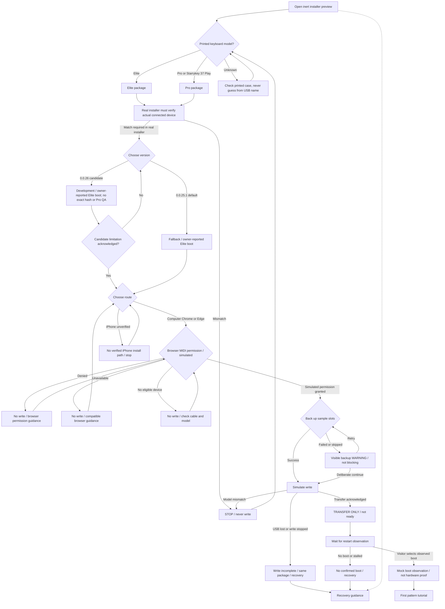
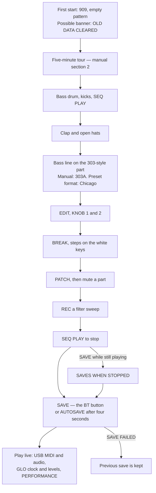
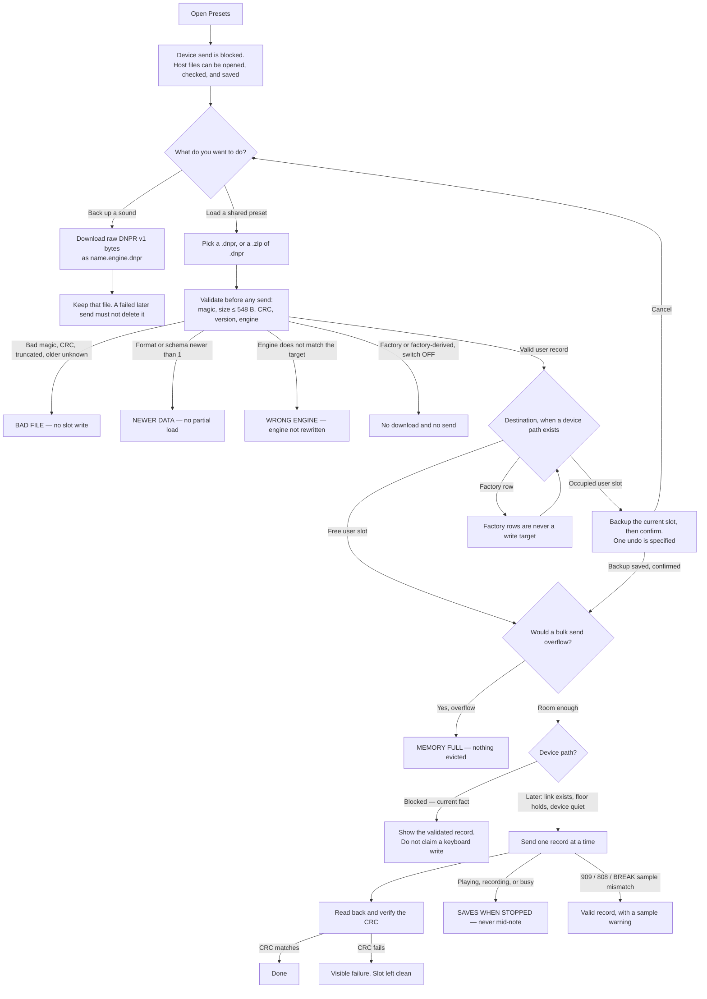

# DnBOX website v2 — install, recovery, first use, and preset flows

Companion to `ia.md`. This is a design of decisions, not a live installer and not a device test. Buttons in the prototype move between simulated states; they never request MIDI permissions, write firmware, inspect hardware or save files. Sources and fetch times are the same as in `ia.md`.

Older PNG renderings `flow-install.png` and `flow-presets.png` are retained for history. **The install PNG is superseded by the diagram below** and must not be treated as the current flow or test evidence.

---

## 1. Install and recovery

Default version is **0.0.25.1**, the known-good fallback (nightly `/new/`, nightly `/manual/`). A 0.0.26 replacement candidate at `94197fc8` may be chosen only after its limits are shown. The withdrawn original 0.0.26 at `600b3b45` is not offered. Recovery is reachable from the first state, before any write. Device identity is the name printed on the keyboard **and** the installer’s check of the connected device; a USB or port name is not confirmation (nightly `/manual/`: “A connection name is not proof of the board model”).

The iPhone route is **UNVERIFIED**, with no validated app, OS, connection procedure or completed DnBOX install; the preview does not allow it to proceed. Computer Chrome/Edge is the documented route. A failed or skipped sample-slot backup produces a visible **warning only** (c237b0d1), never a mandatory install gate. Transfer, restart and observed boot are distinct.

**Failure branches, in words.**

| What happened | What the page says | Next step |
|---|---|---|
| Connected device does not match the chosen package | Stop. Do not write. A USB name is not proof. | Choose the matching Elite or Pro package. |
| USB lost mid-write | The write stopped. A dark display can be normal; do not power-cycle to “fix” it. This page cannot tell whether the keyboard will start on its own. | Replug, resume the **same** package. |
| Write interrupted | Same as above. Do not switch to a different package to “rescue” a half-write. | Replug, finish the same package. |
| Screen black, or stuck at Restarting, after a write | Retain the log, the package version, and the exact model. | Recover: installer restore to M-VAVE stock, or M-UPGRADE. Report those three facts. Do not install another device’s stock firmware. Do not reinstall withdrawn 0.0.26 (`600b3b45`). |
| Original 0.0.26 already on the device | That package was withdrawn after black-screen / Restarting reports. | Restore stock. Do not reinstall it. |
| Browser MIDI denied/unavailable, or no eligible device | No bytes transferred; this is not an installation failure. | Give the specific permission, browser or cable/model guidance. |
| Sample-slot backup failed or was skipped | WARNING: samples may be lost; no successful backup is claimed. | Offer retry **or deliberate continuation**; never block the install solely because backup failed. |
| Transfer acknowledged, but no restart/boot observation | Firmware bytes being sent is not a playable firmware boot. | Remain at transfer/restart check; no Ready banner or complete-success state. |
| Visitor is on iPhone | No validated app/OS/connection or DnBOX installation was demonstrated. | Mark **UNVERIFIED**, do not offer this route as supported, and direct to the documented computer path. |

---

## 2. First use, after a confirmed install

Grounded in the production playing manual, with SMK-37 names from `SMK37.md`, and with the nightly manual’s warning that older X0X documentation may describe a different device. Steps that are FM-1-specific and not restated for the SMK-37 are marked UNVERIFIED on the page.

**Saving** (production manual §15): SAVE stores sounds, 32 patterns, the song, knob motion, tempo and settings. AUTOSAVE is on by default and runs four seconds after you stop and leave the controls, and says AUTOSAVED. It never saves while the pattern plays. Hold SAVE to see the current save state. You lose unsaved changes when you switch off.

**Live** (production README; manual §15–§16): the keyboard is a MIDI device and a USB audio interface, no driver. GLO sets clock out, notes out, and USB AUDIO (FOLLOWS KNOB or FULL). PERFORMANCE shows load; GUARD means the firmware is lightening the load to keep playing. Bluetooth MIDI and clip-mode APC40 are experimental and not hardware-verified, and are mentioned only with those words.

---

## 3. Preset file transfer

The contract is `docs/plans/2026-11-13-preset-file-io-research.md`. Section references below are to that document unless noted. **Live device send is not available:** the codec is unwired, blocked on flash headroom (introduction, R3, §5). The host librarian — pick a file, validate, download a backup — can already be specified. The right-hand side of the diagram is the later device path, drawn so Installer QA can test the page’s behaviour, and marked blocked.

There is no “device match” on Elite versus Pro in this document. Engine match is `WRONG ENGINE`. Elite/Pro interchange is **UNVERIFIED**.

**Validation, as the contract defines it** (research §4, R1, R2; visible words also in the format plan §2, which the research points at):

| Check | Failure word | Source |
|---|---|---|
| Magic `DNPR`, not truncated, CRC as in the plan | `BAD FILE` | research §4, R2 |
| Older unknown format | `BAD FILE` | research R2 |
| Format or schema newer than 1 | `NEWER DATA` (no partial load) | research §4, R2 |
| Engine does not match a given target | `WRONG ENGINE` | research §4 |
| Occupancy would overflow | `MEMORY FULL` (no eviction) | research §4, R3 |
| Factory / factory-derived while the export switch is OFF | no download, no send | research §4, R2, §5 |
| Size | max 548 bytes | research §4 |
| Elite vs Pro “device match” | **not defined** — UNVERIFIED | research doc is silent; format plan §1 has no model field |

**Overwrite.** Occupied user slot: ask, take a backup first, then one undo (research R2, referring to the UX spec’s confirm + undo). Failed sends leave the user’s file alone (research §2.1, §4).

**Bulk.** A zip of individual `.dnpr` files on the host, sent one at a time when a device path exists. No v1 “bank” wire format (research R4).

**Not built, and not claimed.** Web MIDI SysEx (optional later, R3). Web Serial (not in v1). A plugin converter (R3, §5). Live device send while the flash floor does not hold.
